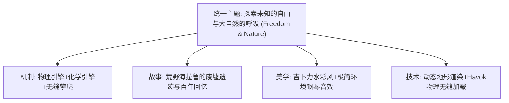
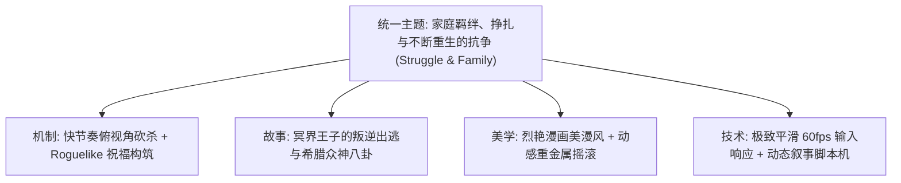
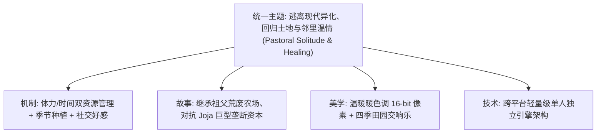
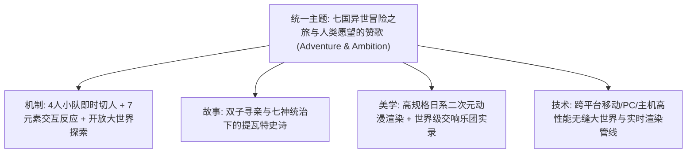

# 经典游戏深度解构案例库 (Masterclass Case Studies)

> **来源与适用范围**：本页是书籍方法论、公开行业实践与仓库自定义启发式规则的二次整理；具体阈值必须结合品类、引擎和玩家测试校准。详见 [来源与校准规范](../../SOURCE_PROVENANCE.md)。


> “伟大的游戏不是偶然诞生的奇迹，而是四大元素精密共振、数十副透镜严苛审视后的必然产物。”  
> —— Jesse Schell，《游戏设计的艺术：透镜之书》

本案例库精选 5 款在游戏设计维度具有教科书级别意义的行业标杆作品，深入拆解其**元素四元组映射、核心透镜应用、系统动力学平衡与设计哲学**，为 AI 协同设计与方案生成提供高质量的少样本（Few-Shot）参考基准。

---

## 案例 1：《塞尔达传说：旷野之息》(The Legend of Zelda: Breath of the Wild)



### 1. 塞尔达传说：旷野之息：元素四元组 (Elemental Tetrad) 解构
- **技术 (Technology)**：定制化 Havok 物理引擎与自研“化学引擎”（物质属性：木/金属/水/火/冰/电），支持任何物体间的物理推拉与元素传导。
- **机制 (Mechanics)**：
  - 核心动词：攀爬任何表面、滑翔、磁力抓取、静止锁、遥控炸弹、冰柱制造。
  - 涌现机制（Emergence）：火点燃草地产生上升气流 $\rightarrow$ 玩家张开滑翔伞升空 $\rightarrow$ 空中拉弓触发林克时间 $\rightarrow$ 射击敌人爆头。
- **故事 (Story)**：极简非线性叙事。百年前毁灭的海拉鲁大陆，玩家通过 12 张照片回忆碎片自发拼凑过往，达成“去任何地方都符合剧情设定”的完全自由。
- **美学 (Aesthetics)**：宫崎骏/吉卜力风格的非写实渲染（NPR），清澈明亮；背景音乐大幅留白，以随风摇曳的单音符钢琴和蝉鸣鸟叫烘托孤独与大自然之美。

### 2. 塞尔达传说：旷野之息：核心透镜穿透解析
1. **【#1 基础体验透镜】**：
   - 目标体验是**“在广袤未知的大自然中自由奔跑与发现的纯粹喜悦”**。所有 UI 均可完全关闭（Pro UI 模式），去除小地图黄点指引，将玩家注意力完全归还给自然景观。
2. **【#43 间接控制透镜】与【#21 空间透镜】—— 三角法则 (The Triangle Rule)**：
   - 地形设计大量采用三角形山丘与巨石。山坡在视线上遮挡了后方的景观，当玩家翻越山顶时，瞬间豁然开朗（Prospect & Refuge），看到神庙、怪物营地或呀哈哈（Korok），形成持续的“好奇 $\rightarrow$ 攀登 $\rightarrow$ 发现 $\rightarrow$ 奔向下一个目标”的闭环。
3. **【#32 有意义的选择透镜】—— 武器耐久系统**：
   - 武器易损毁的设计在初期备受争议，但本质上是**破除支配策略的关键剪刀**：它迫使玩家不断切换武器类型、使用环境陷阱（滚石、引雷、炸药桶）、尝试潜行或化学反应，杜绝了“一把神剑砍通关”的无脑单调。

---

## 案例 2：《Hades》(黑帝斯)



### 1. Hades：元素四元组 (Elemental Tetrad) 解构
- **技术 (Technology)**：极低延迟输入响应，自研动态叙事图谱脚本引擎（数十万句台词根据玩家前一局的死亡地点、击杀者、携带武器无缝动态触发）。
- **机制 (Mechanics)**：轻击、重击、特殊技能、冲刺、投掷 5 维操作动词；结合 8 位奥林匹斯主神的祝福（Boon）产生数千种 Synergy 构筑（如双重祝福、传说祝福）。
- **故事 (Story)**：**教科书级的玩法叙事协同 (Ludonarrative Harmony)**。主角扎格柔斯是不死之身，在冥界“死亡”不是游戏失败，而是“回到冥王圣殿老家”，触发与老爹、修普诺斯、阿喀琉斯的新对话，彻底消解了死亡挫败感。
- **美学 (Aesthetics)**：高对比度插画漫画风，角色立绘极具张力；动感现代电声摇滚与希腊传统乐器融合，战斗反馈打击感（Hitstop/屏幕震动）极度多汁（Juicy）。

### 2. Hades：核心透镜穿透解析
1. **【#35 技巧透镜】与【#28 偶然透镜】的完美调和**：
   - 输入随机（每一层选择神明房门、随机三选一祝福）让每局游戏充满新鲜构筑变数；
   - 纯技巧执行（冲刺无敌帧判定、敌人攻击前摇红光提示）保证了高水平玩家即使运气较差也能凭借操作硬实力通关。
2. **【#5 内在价值透镜】与【#88 经济水龙头/沉没口】**：
   - 局内货币（金币，单局重置，用于即时买祝福/回血）与局外持久代币（黑曜石/钥匙/仙酒/泰坦之血，用于永久天赋升级、武器形态解锁、角色好感度赠礼）分流清晰，无论单局成败，玩家永远有“资产沉淀”。
3. **【#26 挑战透镜】—— 惩罚契约 (Pact of Punishment)**：
   - 通关后解锁的“热度系统 (Heat)”将游戏难度细拆为 15+ 维度的独立自定义滑块（敌人加伤害/加护盾/倒计时限制/扣除选择项），让不同操作层级的玩家完全自主掌控心流难度。

---

## 案例 3：《杀戮尖塔》(Slay the Spire)

```mermaid
graph TD
    Theme["统一主题: 在不确定性中步步为营的极限算力博弈 (Calculation & Variance)"]
    Theme --> M[机制: DBG 牌库构筑 + 意图透传 + 遗物被动]
    Theme --> S[故事: 攀登神秘巨塔的宿命论与异化诅咒]
    Theme --> A[美学: 粗粝暗黑克苏鲁手绘风 + 紧凑音效]
    Theme --> T[技术: 确定性伪随机数种子 (Seed) 系统]
```

### 1. 杀戮尖塔：元素四元组 (Elemental Tetrad) 解构
- **技术 (Technology)**：基于 Seed 的严密伪随机算法，支持完全可复现的对局与跨平台竞赛。
- **机制 (Mechanics)**：
  - 核心设计：**怪物意图透明化 (Intent System)**。玩家在出牌前 100% 预知敌人下一步行动（攻击 15 点、施加脆弱、蓄力大招）。
  - 牌库构筑：3 点能量预算/回合，抽牌堆、弃牌堆与消耗堆的动态循环。
- **故事 (Story)**：抽象碎片化叙事，通过问号事件文本传达巨塔的冷酷与扭曲。
- **美学 (Aesthetics)**：功能性极强的极简 UI，卡牌关键数字与状态图标（力量、敏捷、易伤、虚弱）一目了然。

### 2. 杀戮尖塔：核心透镜穿透解析
1. **【#32 有意义的选择透镜】—— 破除支配性策略的典范**：
   - 卡牌并非“越强越好”。如果不加节制抓取高费大牌，会导致牌库臃肿、抽不到关键防御牌瞬间暴毙；
   - 游戏通过问号事件、商人的“删牌服务”（精简牌库）与诅咒牌，让“跳过抓牌 (Skip Card)”成为资深玩家极高频的高价值选择。
2. **【#39 界面透镜】—— 认知负荷最小化**：
   - 怪物头顶直接悬挂意图图标和精准伤害数值，消除了玩家在“猜敌人要干嘛”上的劣质脑力消耗，将 100% 的脑力集中于“如何在有限的 3 点能量下做最优费用分配”。
3. **【#29 简单 vs 复杂透镜】—— 涌现复杂性 (Emergent Complexity)**：
   - 单张卡牌的规则描述极短（如“造成 6 点伤害”、“获得 5 点格挡”），但与遗物（如死灵之书、苦无、手里剑）和力量层数结合后，涌现出无限深度的流派连携（防战、毒贼、无限流、心智流）。

---

## 案例 4：《星露谷物语》(Stardew Valley)



### 1. 星露谷物语：元素四元组 (Elemental Tetrad) 解构
- **技术 (Technology)**：低硬件门槛的 2D 瓷砖网格（Tilemap）引擎，全平台平滑移植与超快加载。
- **机制 (Mechanics)**：农耕、畜牧、采矿、钓鱼、战斗、社交 6 大支柱体系。严格的体力值与游戏内每日时间（从早 6:00 到凌晨 2:00，约现实 14 分钟）双重约束。
- **故事 (Story)**：反工业化叙事。主角从压抑的办公室逃离，来到鹈鹕镇，在与镇民的日常互动和节日庆典中重新建立人与人、人与自然的连接。
- **美学 (Aesthetics)**：四季变换的像素光影，春天的樱花花瓣飘落、秋天的落叶与冬天的雪景，配合 Eric Barone 亲手谱写的悠扬田园管弦乐。

### 2. 星露谷物语：核心透镜穿透解析
1. **【#38 节奏透镜】与【#31 心流透镜】—— 嵌套目标系统 (Nested Goals)**：
   - *秒级*：这块地挥锄头、浇水、拔杂草；
   - *日级*：在体力耗尽和凌晨 2 点倒下前赶回家睡觉；
   - *周级*：在周二皮埃尔杂货店开门时购买下一批种子、给暗恋对象送生日礼物；
   - *季级 (28天)*：必须在当季结束前收获防风草，否则换季枯萎；
   - *年级 (终局)*：修缮社区中心全套献祭包、接受第 3 年祖父灵魂的点烛评估。
   - **效果**：玩家永远沉浸在“再过一天就睡”的强力心流吸附中。
2. **【#17 投射透镜】与自决理论 (SDT)**：
   - **自主性 (Autonomy)**：没有强制必须完成的主线。玩家可以选择当钓鱼大师、酿酒大亨、矿洞探险家或甚至加入 Joja 超市走金钱路线。
   - **胜任感 (Competence)**：技能等级提升解锁高级制造配方（洒水器自动化解放劳动力）。
   - **归属感 (Relatedness)**：28 位性格各异的小镇居民，每人拥有独立的好感度剧情与心动时刻。

---

## 案例 5：《原神》(Genshin Impact - Live-Ops 标杆)



### 1. 原神：元素四元组 (Elemental Tetrad) 解构
- **技术 (Technology)**：业界领先的移动端/PC/主机多端互通管线、超大视距 LOD 渲染、高并发全球网络同步与热更新架构。
- **机制 (Mechanics)**：
  - 战斗基石：火/水/雷/冰/风/岩/草 7 元素反应机制（附着、蒸发、融化、超载、感电、冻结、扩散、结晶、绽放、激化），4 角色即时切换产生连环反应。
  - 探索基石：体力条攀爬、滑翔、寻宝罗盘、解谜机关（火把点燃、风车激活、草元素种子）。
- **故事 (Story)**：长线服务叙事。以“国家/版本”为单位更新（蒙德 $\rightarrow$ 璃月 $\rightarrow$ 稻妻 $\rightarrow$ 须弥 $\rightarrow$ 枫丹 $\rightarrow$ 纳塔），每一国深度融合真实世界多元文明神话。
- **美学 (Aesthetics)**：顶尖的二次元三渲二（NPR）着色器、陈致逸与 HOYO-MiX 联合伦敦爱乐乐团等实录的代表性交响乐。

### 2. 原神：核心透镜穿透解析
1. **【#88 经济水龙头与沉没口透镜】—— 现代 F2P 循环**：
   - **硬通货水龙头**：每日委托、深渊螺旋、活动奖励、大世界宝箱产出原石；
   - **核心沉没口**：角色/武器祈愿卡池（抽卡）；
   - **体力水龙头/沉没口**：原粹树脂（160 上限，8 分钟恢复 1 点）严格限制每日圣遗物/天赋材料刷取上限，防止玩家内容消耗过快，保障长线生命周期。
2. **【#97 奖励时刻表透镜】—— 概率与心理保底**：
   - 90 抽大保底机制（50% 歪常驻，次 90 抽必中当期限定），将传统纯赌博的恶性体验转化为“可预期的期望规划”，极大地维护了玩家心理安全感与付费黏性。
3. **【#35 技巧 vs #28 偶然】与【#29 简单 vs 复杂】**：
   - 单个角色仅普攻、E 技能、Q 大招 3 个按键，操作门槛极低；
   - 4 角色切人手法、快照机制（Snapshot）、元素附着内置 CD（ICD）、充能循环构成了深度硬核玩家的技术钻研空间。

---

## 🎯 跨案例设计启示矩阵 (Cross-Case Synthesis)

| 标杆作品 | 破除支配策略的关键设计 | 核心心流引擎 | 玩法叙事协同 (Ludonarrative) |
| :--- | :--- | :--- | :--- |
| **旷野之息** | 武器易损毁 + 元素环境交互 | 三角法则地形 + 望远镜标记 | 废墟末世与任何路线皆合理的探索自由 |
| **Hades** | 随机神明祝福 + 惩罚契约多维自定义 | 房间三选一 + 快速冲刺无敌帧 | 冥界王子死亡回家与老爹众神动态剧情 |
| **杀戮尖塔** | 精简牌库删牌机制 + 诅咒卡牌 | 怪物意图 100% 透明化 | 攀登异化巨塔的未知算力博弈 |
| **星露谷物语** | 四季作物轮换 + 枯萎机制 | 秒/日/季/年五层嵌套目标 | 逃离工业内卷，回归土地与邻里羁绊 |
| **原神** | 7 元素克制与免疫怪 + 4 人切人反应 | 宝箱罗盘 + 体力树脂循环 | 旅行者寻亲与见证提瓦特七国人文愿望 |
