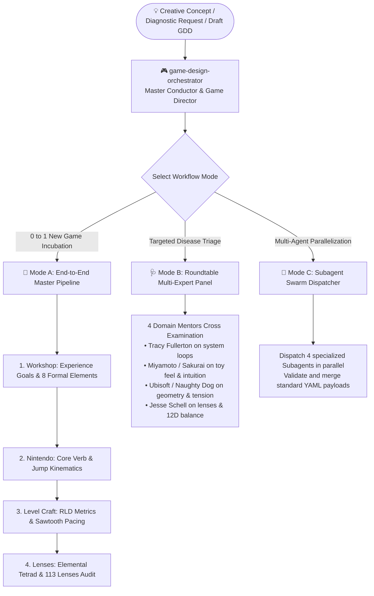

# Game Design Master Orchestrator Skill 🎮🌐

> Unified Master Conductor & Game Director orchestrating **Game Design Workshop**, **Nintendo Design Philosophy**, **Level Design Craft**, and **The Art of Game Design (Book of Lenses)**. Integrates the no-mandatory-dependency Python runtime (`game_design_skills_suite/`, with `game_design_suite.py` as a compatibility entry point) for versioned, schema-validated data interchange and multi-expert panel diagnostics.

English | [简体中文](README_CN.md)

---

## 🌟 Overview & Core Value

This skill acts as a **Game Director & Master Orchestrator**, bridging the gap between mechanics, game feel, level geometry, and systemic balance:



---

## 🚀 Tri-Mode Master Workflows

1. **Mode A: End-to-End Master Pipeline**:
   - Seamlessly incubates concepts from 0 to 1 across all 4 engines to produce a prototype-ready *Master GDD draft* whose assumptions are explicitly marked for playtesting.
2. **Mode B: Roundtable Multi-Expert Triage**:
   - Cross-examines design problems with all 4 mentors and yields a surgical *Keep / Cut / Tune action plan*.
3. **Mode C: Subagent Swarm Dispatcher**:
   - Automatically defines and dispatches 4 specialized subagents (`WorkshopArchitect`, `NintendoToyTuner`, `LevelCraftsman`, `SchellAuditor`) and merges their payloads.

---

## 🛠️ Python Suite Integration

```bash
# 1. Run end-to-end pipeline CLI
python game_design_suite.py pipeline --concept "Grappling Hook Ruins" --verb "Magnetic Hook" --preset souls_arpg

# 2. Pipe feel calculation directly into level geometry solver
python game_design_suite.py feel --height 3.5 --apex_time 0.38 --export-yaml | python game_design_suite.py metrics --from-payload -

# 3. Interactive diagnostic triage wizard
python game_design_suite.py triage
```

---

## 📚 Directory Layout

```
game-design-orchestrator/
├── SKILL.md                          # Main skill prompt and tri-mode workflow instructions
├── README.md                         # English documentation
├── README_CN.md                      # Chinese documentation
├── scripts/game_design_suite.py      # Thin launcher for the shared root CLI
└── references/                       # In-depth reference manuals
    ├── orchestration-protocol.md     # Pipeline state machine and payload contracts
    ├── subagent-swarm-guide.md       # Subagent archetype prompts and merge rules
    └── master-templates.md           # Master GDD and surgical triage report templates
```
