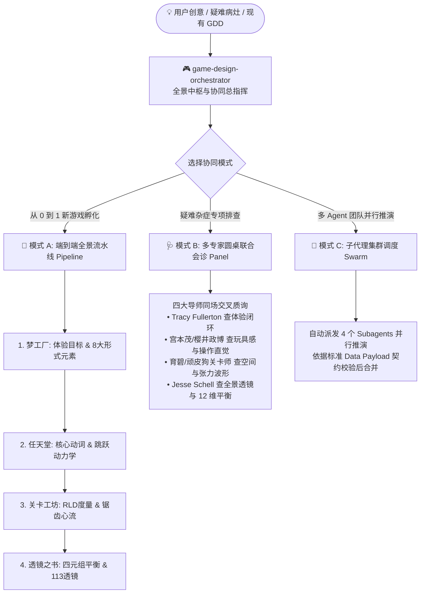

# 游戏设计全景协同中枢技能 (Game Design Master Orchestrator) 🎮🌐

> 统一协同 **《游戏设计梦工厂》**、**《任天堂设计哲学》**、**《关卡设计大师》** 与 **《透镜之书》** 四大专业设计引擎的 Master 总指挥中枢。集成无强制第三方依赖的共享运行时（`game_design_skills_suite/`，`game_design_suite.py` 为兼容入口），提供版本化、严格校验的数据流转与多专家圆桌会诊。

[English](README.md) | 简体中文

---

## 🌟 核心定位与能力

本 Skill 扮演**游戏总制作人 / 主策划总监 (Game Director & Master Orchestrator)**，解决传统游戏设计中“机制、手感、关卡、数值各自为政”的割裂问题：



---

## 🚀 三大协同工作模式

1. **模式 A：端到端全景流水线 (End-to-End Master Pipeline)**:
   - 0 到 1 完整贯穿 4 大技能，输出可进入原型与玩家测试阶段的《全域生产导向 GDD 草案》。
2. **模式 B：多专家圆桌联合会诊 (Roundtable Multi-Expert Triage)**:
   - 针对具体设计病灶，四大流派导师同场质询，输出 Keep / Cut / Tune 外科手术清单。
3. **模式 C：多 AI Agent 集群调度派发 (Subagent Swarm Dispatcher)**:
   - 自动生成并派发 4 个高度特化的子 Agent 并行作业并合流。

---

## 🛠️ 配套 Python 工具箱命令

```bash
# 一键端到端全景流水线推演
python game_design_suite.py pipeline --concept "磁力钩爪废墟探险" --verb "磁力钩爪" --preset souls_arpg

# 跨技能管道流转：手感动力学 -> 关卡安全跨度
python game_design_suite.py feel --height 3.5 --apex_time 0.38 --export-yaml | python game_design_suite.py metrics --from-payload -

# 启动透镜病灶导诊向导
python game_design_suite.py triage
```

---

## 📚 目录结构

```
game-design-orchestrator/
├── SKILL.md                          # 技能主提示词与协同工作流规范
├── README.md                         # 英文说明文档
├── README_CN.md                      # 中文说明文档
├── scripts/game_design_suite.py      # 共享根 CLI 的轻量启动器
└── references/                       # 核心参考手册
    ├── orchestration-protocol.md     # 全景协同总线协议与数据契约
    ├── subagent-swarm-guide.md       # 多 Agent 角色卡模版与调度指南
    └── master-templates.md           # 生产导向 GDD 草案与体检模版库
```
