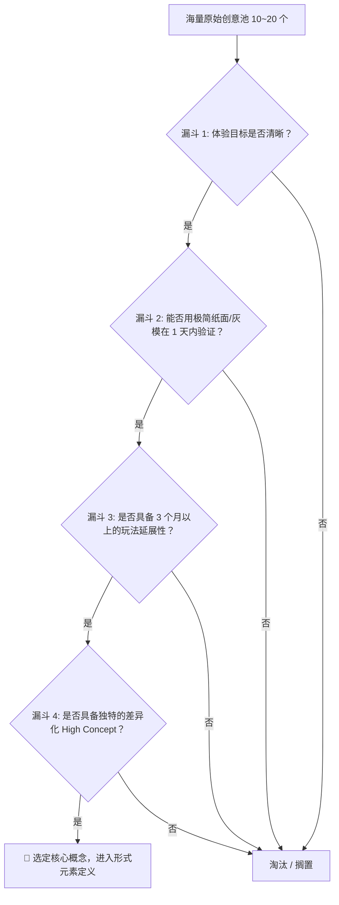

# 游戏创意发散与头脑风暴指南 (Ideation & Conceptualization Guide)

> **来源与适用范围**：本页是书籍方法论、公开行业实践与仓库自定义启发式规则的二次整理；具体阈值必须结合品类、引擎和玩家测试校准。详见 [来源与校准规范](../../SOURCE_PROVENANCE.md)。

《游戏设计梦工厂》（Game Design Workshop）第 6 章指出：伟大的游戏很少诞生于灵光一闪的纯运气，而是诞生于**系统化、结构化的创意发散与筛选漏斗**。

---

## 1. 创意的四大发散引擎 (Ideation Engines)

当面对白纸不知从何开始构思时，使用以下 4 种原著核心发散方法打通灵感通道：

### 1.1 约束头脑风暴法 (Brainstorming Under Constraints)
**“限制产生自由，无限制产生瘫痪。”** 故意给设计设定极度苛刻的硬性约束，迫使大脑跳出思维定势：
- **操作输入约束**: “如果整款游戏只能用 1 个按键（One-Button Game）或者手机重力感应操作，怎么做出深度的即时战斗？”
- **物理空间与时间约束**: “如果整个游戏只发生在一台运行中的电梯里，且每局游戏严格只有 60 秒？”
- **资源与能见度约束**: “如果玩家在游戏中完全失明，只能依靠声音回响与手柄震动感知敌人？”

### 1.2 经典游戏反转与机制魔改 (Modding & Mechanics Inversion)
挑选一个广为人知的成熟游戏，对其核心形式元素进行**“反向颠覆”**或**“跨品类杂交”**：
- **规则反转 (Rule Inversion)**:
  - 《俄罗斯方块》反转：重力向上，玩家需要用方块搭建通天梯逃脱岩浆。
  - 《赛车竞速》反转：谁最慢到达终点谁获胜，但不能停在原地，必须时刻维持移动。
- **互动模式异化 (Mode Transformation)**:
  - 把纯对抗的《格斗游戏》改成双人合体控制一个角色的合作过关游戏。
  - 把单机解谜《推箱子》改成多人抢夺箱子推向对方阵地的 PvP 夺旗战。

### 1.3 日常非游戏体验提炼 (Emotional Core Extraction)
观察现实生活中的非游戏日常体验，剥离表象，提炼其**核心心理张力、动词与反馈回路**：
- **生活场景**: “深夜在自习室/办公室偷偷吃脆脆的薯片（害怕发出声音被发现）”。
  - $\to$ *机制提炼*: 声音分贝检测 + 节奏条预判 + 视线盲区潜行机制。
- **生活场景**: “在暴风雨中护送摇晃的生日蛋糕回家”。
  - $\to$ *机制提炼*: 物理惯性平衡 + 动态风向风力扰动 + 易碎度容错槽。

### 1.4 肢体风暴法 (Body Storming & Physical Roleplay)
- 离开电脑屏幕和纸笔，设计者与团队成员亲自扮演游戏中的角色、子弹、障碍物甚至 AI。
- 通过在房间里奔跑、推拉、阻挡来真实感受空间距离、反应时间与身体本能。
- 能够最快发现“机制是否反直觉”、“等待时间是否令人烦躁”。

---

## 2. 创意矩阵发散法 (The 3x3 Idea Matrix)

将【核心动词】、【戏剧前提/情境】与【系统意外变量】组合为交叉矩阵进行随机碰撞：

| 核心动词 (Verb) | 奇特情境 (Premise) | 动态扰动变量 (Modifier) | 碰撞诞生的高概念 (High Concept) |
| :--- | :--- | :--- | :--- |
| **吸附 / 弹射** | 微观人体血液细胞 | 周期性心跳脉冲与血压激增 | 扮演白细胞，利用心跳泵血洪流弹射歼灭病毒 |
| **缝合 / 拼接** | 废弃人偶玩具修理店 | 零重力悬浮环境 | 拼装不同零件人偶，在漂浮仓库中利用反作用力推演解谜 |
| **折叠 / 展开** | 折纸折痕迷宫 | 时间顺流与倒流交替 | 通过折叠 2D 纸面连通断崖，让过去与未来的自己协同通关 |

---

## 3. 创意筛选与评估漏斗 (Idea Screening Funnel)

在发散产生 10~20 个原始点子后，切忌盲目开工。通过以下 4 道漏斗严苛筛选，最终保留 1~2 个最强概念：

---

## 4. 创意突破自我审问清单 (Self-Interrogation Checklist)

在确立最终方向前，逐项向自己提问：
1. **纯粹动词测试**: “如果把所有的剧情、美术、世界观全部扒掉，只剩几个方块在做核心操作，它好玩吗？”
2. **两句话解释**: “我能否在 15 秒内向完全不玩游戏的外行朋友讲清楚这个游戏最爽的点是什么？”
3. **痛点预见**: “这个机制最容易让玩家产生疲劳或挫败的地方在哪里？我们如何用系统负反馈化解它？”
