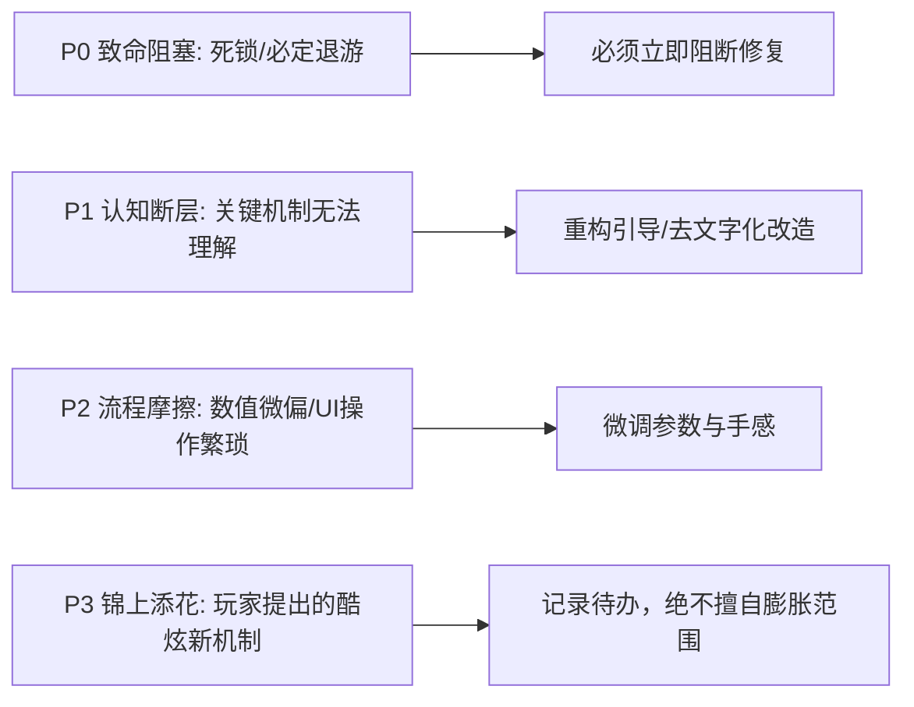

# 玩家测试与体验评估方法论 (Playtesting & Metrics Guide)

> **来源与适用范围**：本页是书籍方法论、公开行业实践与仓库自定义启发式规则的二次整理；具体阈值必须结合品类、引擎和玩家测试校准。详见 [来源与校准规范](../../SOURCE_PROVENANCE.md)。

《游戏设计梦工厂》（Game Design Workshop）将**玩家测试（Playtesting）**视为整个以玩为中心设计哲学的基石。测试不是为了证明你的设计是对的，而是为了**暴露盲点、验证假设、发现未被预料的乐趣与痛点**。

---

## 1. 测试的五个进阶阶段 (Stages of Playtesting)

| 阶段 | 测试对象 | 核心目标 | 关键行动 |
| :--- | :--- | :--- | :--- |
| **1. 自我测试 (Self-Testing)** | 设计师自己 | 验证规则基本运转、排查致命死锁与数字溢出 | 反复推演极端情况（如所有人都选防守、抽不到关键卡） |
| **2. 密友测试 (Confidant Testing)** | 亲近的设计师、同事、朋友 | 获得安全、快速的初步概念反馈 | 讨论核心机制的吸引力与理解难度 |
| **3. 小组测试 (Group Playtesting)** | 目标玩家群体的小样本 (3-5人) | 观察核心玩法循环、心流体验与微观平衡 | 记录玩家行为反应与情绪波动 |
| **4. 盲测 (Blind Playtesting)** | 完全不认识的陌生玩家（无任何外部讲解） | 检验规则书、教学关卡与 UI 的自解释能力 | 设计师全程闭嘴，仅通过文字/界面让玩家自行摸索 |
| **5. 焦点小组与大规模测试 (Focus Groups & Broad Testing)** | 目标市场用户大样本 | 收集受众画像偏好、长期留存欲望与商业化反馈 | 结合问卷、访谈与后台遥测数据（Telemetry） |

---

## 2. 玩家测试现场的三大铁律 (Golden Rules)

1. **绝对不要在测试中教玩家玩游戏 (Do NOT Teach or Defend)**:
   - 当玩家困惑、按错键或走错路时，**忍住不要提示**！这正是你的引导或界面设计存在严重问题的最真实证据。
   - 绝不要为自己的设计做辩护（“其实这个设定是因为后面有某某情节……”），玩家的感受永远是事实。
2. **观察行为远胜于听取意见 (Actions Speak Louder Than Words)**:
   - 玩家经常会“嘴上说很好玩，身体却不停打哈欠/看手机”；或者“嘴上抱怨难度太高，手里却死死抓着手柄重试了20次”。
   - 重点记录：玩家在哪里停顿？在哪里皱眉？何时发笑？何时出现挫败叹气？
3. **倾听问题，但不要盲信玩家提出的解决方案 (Listen to the Problem, not the Solution)**:
   - 玩家是感受痛点的专家，但绝大多数玩家不是系统工程专家。如果玩家说“把这个 Boss 的血量砍掉一半”，核心问题可能是“Boss 招式前摇太隐蔽导致反应不及”，而非纯数值问题。

---

## 3. “有声思维法”主持人实操话术手册 (Think-Aloud Protocol Script)

让玩家在游玩过程中自言自语说出内心的思考、困惑与期待，是捕获认知负荷与心智模型的最强武器。

### 3.1 测试开场定调词 (Opening Script)
> “你好！非常感谢你今天来帮我们测试。在开始前我想特别强调两件事：
> 1. **我们今天是在测试这个游戏，绝对不是在测试你的水平或智商**。如果你在游戏中卡住了、迷路了或者觉得无聊，这全部都是我们设计的缺陷，对我们来说是最宝贵的发现。
> 2. 请在游玩过程中尽量**把你想到的所有东西都‘自言自语’大声说出来**——比如你现在想去哪、你在找什么、你在担心什么、为什么按这个键。不要担心说错，你的每一个念头对我们都至关重要。
> 3. 我会全程坐在旁边安静记录，除非遇到致命 Bug，否则我不会提供任何操作提示。现在请尽情开始吧！”

### 3.2 游玩中沉默激活话术 (Prompts for Silence)
当玩家陷入长时间沉默（> 10 秒）或出现皱眉困惑时，使用**中立、非引导性短语**促思：
- “你现在心里在考虑什么？”
- “你刚才这几秒钟试图达成的目标是什么？”
- “是什么让你在这里停顿了一下？”
- *(切忌说：“你是不是找不到开门的开关？”——这会破坏测试)*

---

## 4. 主观反馈 vs 客观行为冲突诊断矩阵

| 现象类型 | 玩家口头表达 | 玩家实际肢体/行为表现 | 真正的底层病灶与诊断 | 外科手术调整方向 |
| :--- | :--- | :--- | :--- | :--- |
| **客套型伪好评** | “挺好玩的，很有创意！” | 游玩中频繁看手机、打哈欠、通关一次后拒绝重玩 | 机制缺乏深度张力，核心循环没有提供真正的多巴胺高潮 | 砍掉冗长前戏，强化核心冲突的高危与高回报 |
| **受虐型真沉迷** | “这游戏太反人类了！恶心死了！” | 死死抓着手柄，连续重试 15 次，通关瞬间大叫欢呼 | 挑战难度高但技能反馈极度正向（魂系高心流） | 保留高难度，仅优化死亡重开跑图距离与加载时间 |
| **引导性认知障碍** | “我觉得这个 Boss 数值太超标了，根本打不过” | 每次都在 Boss 放全屏大招时站在红圈正中央硬吃伤害 | 并非数值问题，而是危险前摇特效（Telegraphing）缺乏清晰视听提示 | 增强大招起手音效、红圈边缘闪烁与受击硬直反馈 |

---

## 5. 测试问题与缺陷严重度分级 (Issue Severity Triage)

测试结束后，将所有发现的问题按严重度四级分流，决定迭代优先级：

- **P0 - 致命级 (Blocker)**: 出现死锁、规则不可解、必输死循环，玩家完全无法推进。
- **P1 - 严重级 (Critical Friction)**: 超过 50% 盲测玩家未能理解核心操作或误用了严重降低乐趣的支配性消极策略。
- **P2 - 一般级 (Moderate Polish)**: 机制逻辑通顺，但局部数值节奏偏慢、等待时间过长或 UI 层次不够清晰。
- **P3 - 建议级 (Minor Enhancement)**: 玩家随口提出的“如果能加个宠物系统就好了”等外围脑洞。

---

## 6. 测试后访谈与提问技巧 (Debriefing Techniques)

### 6.1 避免引导性提问 (Avoid Leading Questions)
- ❌ **错误提问**: “你觉得刚才拿到的那把火焰剑是不是很酷？”（强行引导好评）
- ✅ **正确提问**: “刚才探索过程中，哪件装备给你的印象最深？为什么？”
- ❌ **错误提问**: “第三关是不是有点太难了？”
- ✅ **正确提问**: “在整个通关过程中，你觉得最吃力或最顺畅的节点分别在哪里？”

### 6.2 深度挖掘三步提问法
1. **现象定位**: “刚才在第 2 回合，我注意到你犹豫了很久才出牌，当时你在考虑什么？”
2. **动机剖析**: “在当时的情况下，你最想做的事情是什么？有什么阻碍了你？”
3. **情绪确认**: “那一刻你感受到的是挑战带来的兴奋，还是不知所措的困惑？”
