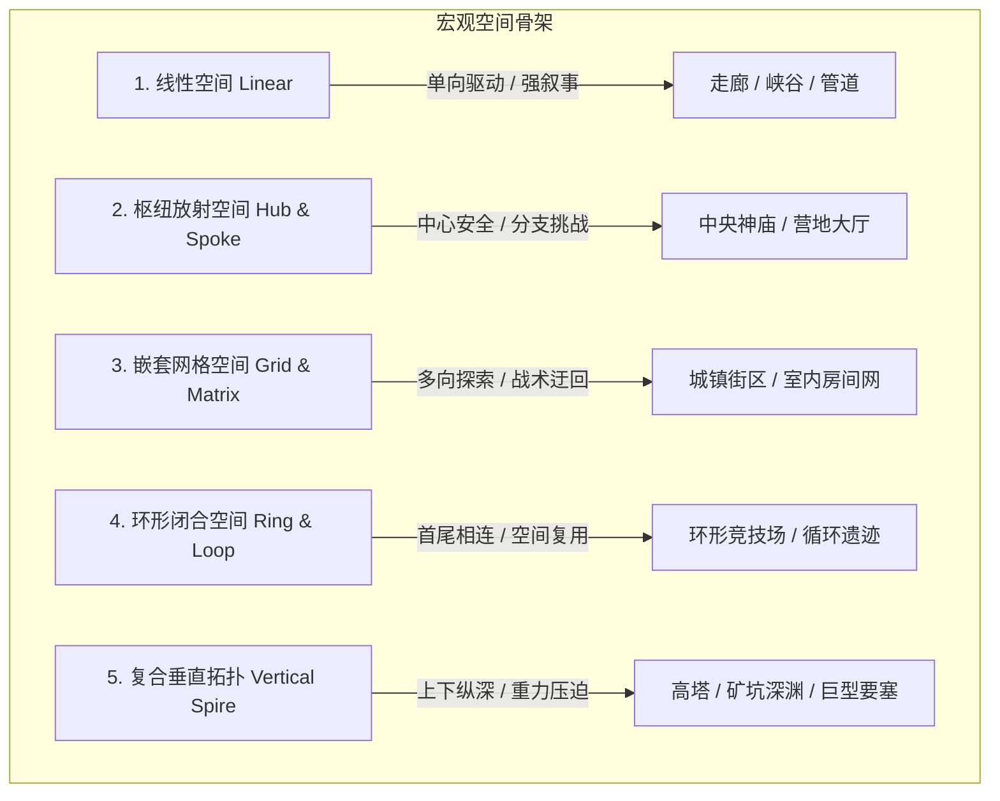

# 建筑学空间构成与画框构图指南 (Architectural Space & Composition Guide)

> **来源与适用范围**：本页是书籍方法论、公开行业实践与仓库自定义启发式规则的二次整理；具体阈值必须结合品类、引擎和玩家测试校准。详见 [来源与校准规范](../../SOURCE_PROVENANCE.md)。


> 本手册提炼自 Christopher W. Totten 经典专著《An Architectural Approach to Level Design》（建筑学关卡设计方法）与现实空间建筑心理学，解析如何利用空间几何、透视画框、开阔与庇护理论打造具有情绪张力与沉浸感的关卡。

---

## 1. 空间类型学与拓扑原型 (Spatial Typologies)

关卡空间的几何拓扑直接决定了玩家在空间内的心理预期与行动自由度：



### 空间形态的情绪心理学映射

| 空间形态 | 典型几何特征 | 唤起的玩家情绪 | 最佳应用场景 |
| :--- | :--- | :--- | :--- |
| **窄高型 (Vertical Narrow)** | 宽度 $< 2\text{m}$，高度 $> 8\text{m}$ | 压迫、渺小、紧迫、被监视感 | 逃生追逐、潜入窄巷、恐怖游戏走廊 |
| **低矮开阔型 (Low Horizontal)** | 高度 $< 2.5\text{m}$，视野开阔 | 幽闭、潜伏、战术紧张、窒息感 | 通风管道、地下防空洞、低矮废墟 |
| **全景宏伟型 (Monumental Vista)** | 宽深高全向超大比例，穹顶/天际线 | 震撼、敬畏、神圣、崇高、探索渴望 | 走出洞穴初见大世界、最终 Boss 殿堂 |
| **迷宫错落型 (Labyrinthine)** | 视线频繁被拐角阻断，无直视视距 | 迷茫、警惕、惊悚、转角遇敌危机 | 下水道、受感染实验舱、古老迷宫 |

---

## 2. 展望与庇护理论 (Prospect & Refuge Theory)

地理学家 Jay Appleton 提出的“展望与庇护理论”是关卡空间安全感与紧张感设计的核心灵魂：

```
+--------------------------------------------------------+
|                PROSPECT (开阔展望区)                    |
|  - 视野极其开阔，可一览无余地观察整个战局 / 远景地标     |
|  - 自身完全暴露，极易受到来自四面八方的攻击 (高风险)    |
|                                                        |
|     +--------------------------------------------+     |
|     |            TRANSITION (危险过渡带)         |     |
|     |                                            |     |
|     |   +------------------------------------+   |     |
|     |   |         REFUGE (庇护所 / 掩体)     |   |     |
|     |   | - 顶部有遮蔽，背部有实体墙靠背     |   |     |
|     |   | - 视野可观察外部，但敌人无法直视   |   |     |
|     |   | - 安全、可喘息、可制定战术策略     |   |     |
|     |   +------------------------------------+   |     |
|     +--------------------------------------------+     |
+--------------------------------------------------------+
```

### 经典实战公式：
- **安全感知度** $= \frac{\text{庇护所覆盖率 (Refuge)}}{\text{暴露视野角度 (Prospect Angle)}} \times \text{后背防护度 (Backwall Security)}$
- **最佳关卡节奏流**：`庇护所(规划) -> 冲刺跨越危险暴露带 -> 抵达新庇护所(击杀/解谜) -> 登上制高点全景观望(展望高潮)`。

---

## 3. 视线控制与画框构图法则 (Sightlines & Framing)

优秀的关卡设计师如同电影摄影师，利用建筑孔洞（门窗、桥梁、裂缝、天然岩洞）作为取景框（Frame），强行捕获玩家视线：

### 核心构图技术：

1. **画框诱引 (Framing the Landmark)**:
   - 当玩家穿过狭窄昏暗的门洞或走廊尽头时，**门框必须恰好框住下一个关键目标/宏伟地标**（如一座发光的高塔、一扇巨大的青铜门）。
2. **遮挡与揭示 (Occlusion & Reveal / “先抑后扬”)**:
   - 故意用一面弯曲的矮墙、巨石或坍塌的走廊阻挡视线，当玩家转过转角（Corner Turn）的一刹那，突然展开震撼的全景（The Vista）。
3. **视觉焦点三分法与引导线 (Leading Lines)**:
   - 利用地面的铁轨、天花板垂下的断裂电缆、墙壁上的管道走向，形成自然的斜向平行线，全部汇聚指向通关出口。

```
[黑暗狭窄的通道] ------------> [拐角 90° 旋转] ------------> [天然岩洞画框 Frame]
                                                                     |
                                                                     v
                                                          +--------------------+
                                                          |  远方发光的圣殿     |
                                                          |   (The Landmark)   |
                                                          |   /|\      /|\     |
                                                          |  / | \    / | \    |
                                                          |  引导线汇聚于此点   |
                                                          +--------------------+
```

---

## 4. 门槛与阈限空间 (Thresholds & Liminal Transitions)

在建筑学中，**门槛（Threshold）**是两个不同性质空间的物理与心理分割线。在关卡设计中，门槛承担着**“重置玩家心智状态”、“触发情绪转折”与“关卡节奏隔离”**的核心功能：

1. **压缩与释放 (Compression & Expansion)**:
   - 在进入史诗级大厅或激烈战场前，**必须刻意塞入一段狭窄、低矮、逼仄的过渡通道（Airlock / Squeeze Through）**。
   - 人类生理本能：经历过严重压迫后，进入宽敞空间的爽快感与震撼感将放大 $300\%$。
2. **仪式感门槛 (Ritualistic Thresholds)**:
   - 魂系雾门（Fog Gate）、生化危机推门动画、需要长按按键撬开的重型气密门。
   - 机制功能：切断追兵、预警高危、加载后台数据、心理战备倒数。
3. **不可逆落差 (Point of No Return / Dropdown)**:
   - 从 2 米高台跳下进入竞技场，切断后路。向玩家明确宣告：“安全探索期结束，全面进入生死决战！”

---

## 5. 空间垂直度与权力感 (Verticality & Power Dynamics)

垂直高低差不仅是战术层面的优劣势，更是**心理权力感（Psychological Power）**的直观投射：

```
[居高临下者 (Dominant)]  ----->  拥有 360° 全景视野、重力加速度加成、心理从容感 (掌控者)
         |
         |  视线压迫 (Angle of Oppression)
         v
[低洼仰视者 (Submissive)] ----->  视野严重受限、极易被爆头/偷袭、必须抬头寻找威胁 (受害者)
```

- **从下往上攻（Uphill Battle）**：用于塑造困难、绝望、求生欲望与勇攀高峰的英雄感。
- **从上往下突（Downhill Sweep）**：用于给玩家提供“割草释放”、“特工降临”、“战术碾压”的掌控快感。
- **动态垂直回环**：下层潜行钻通风管道 -> 爬梯子登上二楼主梁 -> 从天花板天窗俯冲刺杀下方指挥官。
