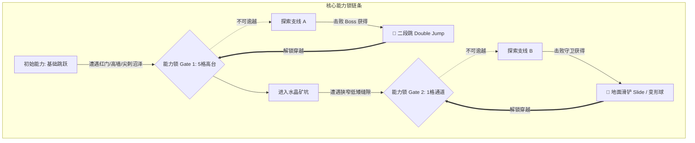

# 2D 平台与银河恶魔城空间拓扑指南 (2D Platforming & Metroidvania Topology)

> **来源与适用范围**：本页是书籍方法论、公开行业实践与仓库自定义启发式规则的二次整理；具体阈值必须结合品类、引擎和玩家测试校准。详见 [来源与校准规范](../../SOURCE_PROVENANCE.md)。


> 本手册提炼自《Super Metroid》《Castlevania: SOTN》《Hollow Knight》《Celeste》《Ori and the Blind Forest》等殿堂级 2D 平台跳跃与银河恶魔城（Metroidvania）游戏的空间设计心法，解析 2D 房间网格、能力锁（Ability Gates）、视口构图与防枯燥回溯拓扑。

---

## 1. 2D 网格与图块度量衡 (Tile Metrics & Room Units)

在 2D 横版关卡中，**图块（Tile / Grid Unit）是构筑空间的原子基石**。所有跳跃弧线、通道高度与障碍尺寸必须严格锁定在离散网格上。

```
+-------------------------------------------------------------------------+
| [2D 银河恶魔城标准单屏房间 Standard 1x1 Room (如 32x18 Tiles)]            |
|                                                                         |
|   +-----------------------+              [天花板单向穿透平台 (Drop-Through)] |
|   | 站立净空 >= 3 Tiles   |                =======================      |
|   +-----------------------+                         | (按 ↓ + 跳跃下穿)  |
|                                                     v                   |
|   [滑铲 / 钻爬通道 Crouch/Slide]         [攀墙跳井 Wall-Jump Chute]      |
|   高度: 1 Tile (无法站立跳跃)             井宽: 3~4 Tiles (支持左右蹬踏) |
|   +-----------------------+              |                     |        |
|   | 仅允许冲刺滑铲通过     |              |  ^               ^  |        |
|   +-----------------------+              |  /               \  |        |
|                                          | /                 \ |        |
|   [地面不可破坏基底 Solid Ground]         |/                   \|        |
+-------------------------------------------------------------------------+
```

### 核心 2D 度量标准参考（以 $1\text{ Tile} = 1\text{m}$ 或 $16\text{px}$ 为基准）：

| 空间要素 | 标准度量 | 设计意图与物理法则 |
| :--- | :--- | :--- |
| **基础单段平跳高度** | $3.0 \sim 3.5\text{ Tiles}$ | 基础跳跃无法翻过 $4\text{ Tiles}$ 高墙，形成天然屏障 |
| **二段跳 / 高跳高度** | $6.0 \sim 7.0\text{ Tiles}$ | 获得能力后瞬间打通此前所有 $4\sim6\text{ Tiles}$ 的高台 |
| **滑铲 / 钻爬通道** | 净高 $1.0 \sim 1.2\text{ Tiles}$ | 限制站立状态，强制使用位移动词，创造狭小压迫感 |
| **攀墙跳井宽 (Wall-Jump)**| $3.0 \sim 4.5\text{ Tiles}$ | 过窄无法展开跳跃弧线，过宽无法触碰对侧墙壁 |
| **单向穿透平台 (One-Way)**| 厚度 $0.2\text{ Tiles}$ | 向上可直接跳跃穿透，向下需输入 `Down + Jump` 落下 |

---

## 2. 能力锁与拓扑穿透矩阵 (Ability Gates & Key-Lock Matrix)

银河恶魔城的核心快感在于**“用新获得的能力作为开门钥匙（Ability as Key）”**，重塑玩家对已知空间的认知：



### 经典能力锁类型速查表：

1. **垂直高度锁 (Vertical Gate)**：高悬空平台（需要二段跳、反重力、升龙拳、高跳大招）。
2. **水平跨度锁 (Horizontal Gate)**：宽裂谷、高速强风走廊（需要横向冲刺 Dash、空中多段滑翔）。
3. **空间几何锁 (Spatial Volume Gate)**：仅 1 格高的细小裂缝（需要滑铲、变成球体、缩小药水）。
4. **环境属性锁 (Environmental Gate)**：毒气沼泽、极寒冰原、漆黑洞穴（需要防毒面具、防寒护甲、探照提灯）。
5. **材质破坏锁 (Destructible Gate)**：发光的龟裂石块、重型铁栅栏（需要蓄力重击、下砸冲击波、炸弹）。

---

## 3. 2D 镜头构图与视口边缘安全区 (2D Camera & Viewport)

在 2D 游戏中，玩家没有旋转摄像机的自由，关卡设计师必须与镜头系统紧密配合：

```
+-------------------------------------------------------------+
| 2D 屏幕视口 (Screen Viewport)                                |
|                                                             |
|   +-----------------------------------------------------+   |
|   | 视线前瞻 (Look-Ahead Bias: 沿奔跑方向预留 60% 视野)    |   |
|   |                                                     |   |
|   |         [玩家角色]  ----------> [朝向方向]           |   |
|   |          (位于 40% 偏后)       (前方保留更广观察区)    |   |
|   |                                                     |   |
|   +-----------------------------------------------------+   |
|                                                             |
|   [死角盲区警告 (Blind Pit Hazard)]                          |
|   - 严禁在屏幕底部刚好遮挡的地方放置致命尖刺!                  |
|   - 必须提供向下平移视角的机制 (Crouch Look-Down) 或灯光预警    |
+-------------------------------------------------------------+
```

### 2D 镜头黄金法则：
1. **前进前瞻（Look-Ahead Bias）**：摄像机应略微偏向玩家奔跑的前方，为高速冲刺保留至少 $0.5$ 秒的反应视距。
2. **死跳规避（No Leap of Faith）**：严禁强迫玩家跳向完全看不到落点的屏幕下方。如果必须向下跳，下方必须有光芒照亮落地点，或设计缓降气流。
3. **房间边界锁定（Room Framing / Confining）**：当玩家进入 Boss 战或解谜单间时，镜头边缘应柔和锁死在房间四壁，强化幽闭对决感。

---

## 4. 智能回溯与单向滑轨 (Smart Backtracking & Flow Loops)

银河恶魔城最忌讳“枯燥冗长地原路返回（Tedious Backtracking）”。优秀的空间拓扑会为每一次回溯注入全新体验：

1. **单向滑轨与单向捷径（One-Way Rails & Dropdowns）**：
   - 击败区域 Boss 后，Boss 房间后方必定有一条单向滑坡、升降电梯或跌落竖井，直通初始十字路口（Hub）。
2. **场景动态异变（Dynamic World Inhabitation）**：
   - 当玩家拿到新能力回溯经过旧区域时，旧区域的敌人被感染变异、部分地形塌陷开启新洞口，使旧路充满全新挑战。
3. **能力碾压快感（Power Fantasy Backtracking）**：
   - 昔日需要步步为营躲避的弱小杂兵，在玩家获得冲刺/群攻能力后可以直接高速撞死，将回溯转化为极速跑酷的爽感。
