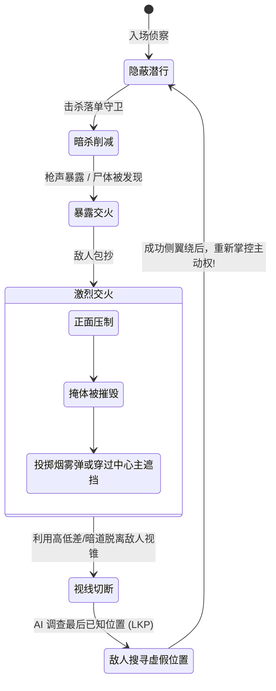

# 宽线性心流与遭遇战竞技场指南 (Wide-Linear Encounters & Arenas)

> **来源与适用范围**：本页是书籍方法论、公开行业实践与仓库自定义启发式规则的二次整理；具体阈值必须结合品类、引擎和玩家测试校准。详见 [来源与校准规范](../../SOURCE_PROVENANCE.md)。


> 本手册提炼自顽皮狗（Naughty Dog，代表作《最后生还者》《神秘海域》）及现代顶级动作/射击游戏的实战心法，解析如何构建兼具“电影级线性张力”与“高自由度战术沙盒”的宽线性遭遇战关卡。

---

## 1. 宽线性漏斗结构 (The Wide-Linear Funnel)

宽线性（Wide-Linear）是解决“纯线性过于单调”与“纯开放世界缺乏叙事张力”的终极解法：

```
[窄通道: 剧情/叙事/过渡] (Choke Point 1)
           |
           v
+-------------------------------------------------------------+
|               宽广遭遇战竞技场 (Wide Combat Arena)           |
|                                                             |
|   [路线 A: 潜行草丛]      [路线 B: 高台狙击]    [路线 C: 室内突袭]   |
|         \                      |                      /     |
|          \                     |                     /      |
|           +--------------------+--------------------+       |
|                                |                            |
|                     [中央主战区 / 敌人重兵]                 |
+-------------------------------------------------------------+
           |
           v
[窄通道: 逃脱门/关卡收束/张力释放] (Choke Point 2)
```

### 核心设计原则：
1. **单点入场与高台侦察（The Perch Entry）**：
   - 玩家进入竞技场的第一瞬间，**必须站在安全的侦察制高点（Perch）**。在此处可清晰俯瞰敌人巡逻路线、关键资源点与 3 条渗透路径，让玩家拥有充足的战术规划时间。
2. **多路径分流与动态收束**：
   - 入口提供至少 2~3 条不同风格的推进动线（潜行暗杀、重装强突、高空绕后），但最终汇聚于唯一的突破口（重铁门/防空洞入口）。

---

## 2. 遭遇战竞技场几何拓扑 (Combat Arena Topology)

一个优秀的战斗竞技场绝对不是一个堆满箱子的正方形房间，而必须具备以下核心几何元素：

```
                          [ 撤离出口 EXIT (Choke Point) ]
                                         ^
                                         |
     +-----------------------------------+-----------------------------------+
     |                                                                       |
     |   [侧翼高台 Flank High]                  [二层回廊 Balcony]           |
     |   - 楼梯直通/提供俯射视角                - 拥有硬掩体与狙击窗         |
     |   - 极佳视野但后背易受袭                 - 连接室内暗道               |
     |                                                                       |
     |              [中心主遮挡物 Heavy Occluder (如废弃卡车/倒塌立柱)]       |
     |              - 彻底阻断全图直线视距 (No Cross-Map Sniping)             |
     |              - 分割为左/右两个独立交火子战区                         |
     |                                                                       |
     |   [掩体集群 Cover Cluster A]             [低矮植被/水沟 Stealth Trench] |
     |   - 半身掩体 + 穿插红油桶                - 允许静音匍匐绕后           |
     |                                                                       |
     +-----------------------------------+-----------------------------------+
                                         ^
                                         |
                        [ 入口高台侦察点 (Perch Entry) ]
```

### 必须坚守的竞技场几何五戒：
1. **视线阻隔（Break Cross-Map Sightlines）**：中心必须有大型掩体阻断对角线视距，防止全图敌人瞬间集火玩家。
2. **多面连通环路（Continuous Looping）**：每个掩体集群必须有至少 2 个出入口，杜绝“死胡同掩体”导致玩家被堵死。
3. **高低差分层（Vertical Layers）**：竞技场至少包含 2 层垂直空间（地面、二楼平台或地下暗道）。
4. **环境互动陷阱（Environmental Hazards）**：爆炸油桶、悬挂的吊灯绳索、发电机电源，赋予玩家利用环境创造击杀的快感。
5. **动态补给点（Resource Drops in High-Risk Zones）**：将最强弹药和医疗包放置在最危险的暴露区，用贪婪驱动玩家转移掩体。

---

## 3. 猫鼠循环与脱战回路 (The Cat-and-Mouse Reset Loop)

现代高阶遭遇战的灵魂在于**“允许玩家在战斗中重置潜行”**，形成动态拉扯的猫鼠游戏：



- **最后已知位置机制（LKP - Last Known Position）**：关卡几何必须提供“快速脱离视线”的 $90^\circ$ 拐角与暗道，让 AI 朝旧位置移动，为玩家创造完美的侧翼包抄（Flank）机会。

---

## 4. 遭遇战心流与张力曲线 (Encounter Tension Beats)

一场 3~5 分钟的经典遭遇战应严苛遵循以下 5 幕节拍：

| 节拍阶段 | 耗时 | 玩家状态 | 关卡设计师的作为 |
| :--- | :--- | :--- | :--- |
| **第 1 幕：侦察与潜入 (Recon)** | 30~60s | 紧张、专注、从容 | 提供入场高台、标记敌人、无警报暗杀 |
| **第 2 幕：爆发与首战 (Alpha Strike)** | 10~20s | 肾上腺素飙升 | 伏击第一波精英怪，警报拉响，正面交火 |
| **第 3 幕：增援与压迫 (Escalation)** | 60~90s | 高度紧张、资源告急 | 刷新第二波敌人（近战冲脸兵+高处狙击手），掩体受损，迫使玩家位移 |
| **第 4 幕：极限突破 (Climax Rush)** | 30~45s | 绝地反击、高潮爆发 | 击杀重装队长，利用重武器清场，冲向收束门 |
| **第 5 幕：解脱与搜刮 (Resolution)** | 30~60s | 极度放松、成就感 | 关门切断追兵，音乐转为舒缓，进入充满战利品的搜刮房间 |
