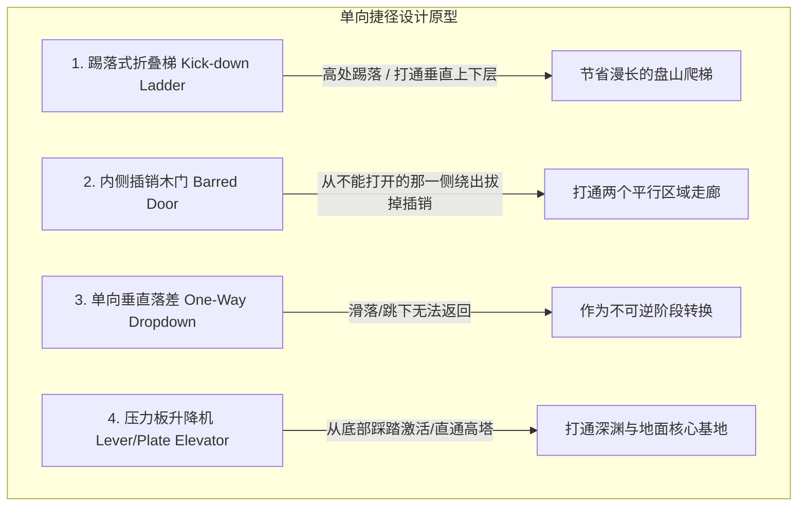

# 瑞士奶酪与非线性空间拓扑指南 (Swiss Cheese & Non-Linear Topology)

> **来源与适用范围**：本页是书籍方法论、公开行业实践与仓库自定义启发式规则的二次整理；具体阈值必须结合品类、引擎和玩家测试校准。详见 [来源与校准规范](../../SOURCE_PROVENANCE.md)。


> 本手册提炼自 Arkane Studios（代表作《Dishonored》《Prey》）与 FromSoftware（代表作《Dark Souls》《Bloodborne》《Elden Ring》）的殿堂级空间拓扑哲学，深度解析“瑞士奶酪空间穿孔”、“可见不可达诱导”与“单向回环捷径”的设计精髓。

---

## 1. 瑞士奶酪空间穿孔法则 (The Swiss Cheese Principle)

Arkane 关卡设计的核心铁律：**任何一堵墙、一扇门或一层天花板，都必须像发酵熟透的瑞士奶酪一样布满孔洞与通道**。

```
                              [ 屋顶天窗 / 吊灯横梁 (High Agility Path) ]
                                                |
     +------------------------------------------+------------------------------------------+
     |                                                                                     |
     |   [ 二层阳台窗户 (Stealth Flank) ]           [ 房间主门 (正面交火/重型破门) ]       |
     |   - 需攀爬水管或瞬移到达                     - 重兵把守 / 陷阱警戒线                 |
     |   - 绕过前线直达指挥官寝室                   - 正面硬刚玩家首选                     |
     |                                                                                     |
     |   [ 墙根通风管道 (Tech / Crawl) ]            [ 地下下水道铁栅栏 (Lockpick / Dive) ]  |
     |   - 需滑铲或矮人形态进入                     - 需撬锁技能或潜水绕后                 |
     |                                                                                     |
     +------------------------------------------+------------------------------------------+
```

### 多途径渗透设计矩阵 (The Multi-Path Matrix)：
对于每一个核心目标房间/堡垒，必须同时提供以下 4 种维度的渗透解法：
1. **强攻正面门（Direct / Combat）**：最显眼、最短距离，但承受最高火力与警报惩罚。
2. **高空飞跃道（Vertical / Stealth）**：利用屋檐、阳台、吊灯骨架，避开地面视锥。
3. **隐蔽狭窄缝（Underground / Infiltration）**：下水道、通风管道、坍塌地洞，提供安全但路线绕远。
4. **特殊系统解（Systemic / Puzzle）**：附身老鼠穿越管道、黑客入侵防空炮台、关掉中央电闸制造大面积停电。

---

## 2. “可见不可达”诱引机制 (Teasing & The Gated Vista)

魂系游戏（Souls-borne）最令人拍案叫绝的设计手法就是**“在第 1 分钟让你看到，在第 30 分钟让你拿到”**：

```
[玩家出生点 / 初始篝火] 
      |
      +---> (隔着铁栅栏看到发光的史诗级大剑 / 锁死的单向铁门) [Tease: 种下强烈的欲望种子]
                 |
                 | (开始向外探索冒险，历经千难万险，跋涉 2 公里...)
                 v
            [ 城堡外围盘山路 ]
                 |
                 v
            [ 深入地下墓穴战胜精英怪 ]
                 |
                 v
            [ 乘坐升降梯返回 / 从内侧拉动铁门开关 "KA-CHUNK!" ]
                 |
                 +-------------------> [ 门开了！瞬间回到初始篝火！]
```

### 空间顿悟心理学（The Eureka Moment）：
- 当玩家从另一侧推开一扇门、踢下一架梯子，突然发现自己**竟然回到了半小时前的初始安全屋**时，脑内会瞬间爆发强烈的多巴胺。
- **空间连通感（Spatial Coherence）**：这种设计彻底消除了无聊的“走回头路（Backtracking）”，并将玩家脑海中的零散区域在三维坐标系中瞬间缝合成一个整体。

---

## 3. 单向回环捷径拓扑分类 (Loopback Shortcut Typologies)



### 捷径布局黄金准则：
1. **每个篝火/安全屋辐射 2~3 个回环**：一个优秀的箱庭关卡，通常只需要 1 个中心篝火，通过 3 扇不同方向开启的单向捷径门，覆盖整张地图的 3 个推进阶段。
2. **捷径门的外观辨识度**：从正面看时，必须有明显的“从内侧锁死”视觉线索（如一根粗木桩横梁、一把巨大的内侧插销锁），让玩家一眼明白“我需要去另一边打开它”。
