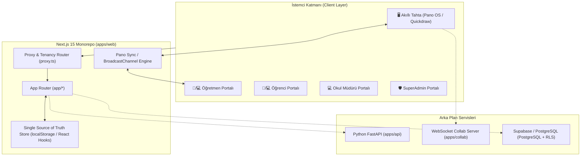
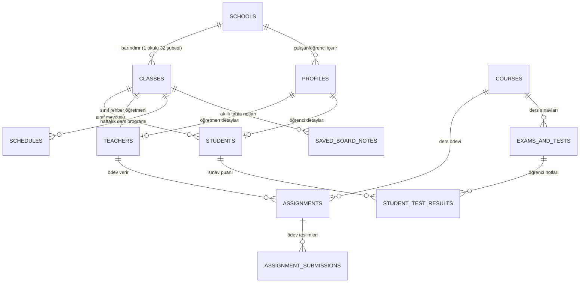

# 🌟 OXONOM EDU — A'DAN Z'YE PROJE İŞLEM AĞACI, EKRANLAR VE VERİ MODELLERİ

Bu doküman, **Oxonom Edu** platformunun tüm mimari yapısını, operasyonel işlem ağacını, sistemdeki **bütün ekranları (linkleriyle birlikte)**, veri modellerini, eklenti ve bileşenlerini eksiksiz biçimde sunar.

---

## 📑 İÇİNDEKİLER
1. [Sistem Mimarisi ve Teknoloji Yığını](#1-sistem-mimarisi-ve-teknoloji-yığını)
2. [Operasyonel İşlem Ağacı (Process & Workflow Tree)](#2-operasyonel-işlem-ağacı-process--workflow-tree)
3. [Tüm Ekranlar ve Rotalar Kataloğu (A'dan Z'ye)](#3-tüm-ekranlar-ve-rotalar-kataloğu-adan-zye)
   - [3.1. Kimlik Doğrulama ve Karşılama Ekranları](#31-kimlik-doğrulama-ve-karşılama-ekranları)
   - [3.2. Akıllı Tahta (Pano OS & Whiteboard) Ekranları](#32-akıllı-tahta-pano-os--whiteboard-ekranları)
   - [3.3. Öğrenci Portalı Ekranları](#33-öğrenci-portalı-ekranları)
   - [3.4. Öğretmen Portalı Ekranları](#34-öğretmen-portalı-ekranları)
   - [3.5. Okul Müdürü Portalı Ekranları](#35-okul-müdürü-portalı-ekranları)
   - [3.6. SuperAdmin (Platform Yönetimi) Ekranları](#36-superadmin-platform-yönetimi-ekranları)
   - [3.7. Eğitsel Oyun Stüdyosu (GameStudio) Ekranları](#37-eğitsel-oyun-stüdyosu-gamestudio-ekranları)
4. [Veri Modelleri ve Varlık İlişkileri (Data Models & ERD)](#4-veri-modelleri-ve-varlık-ilişkileri-data-models--erd)
5. [Eklentiler, Modüller ve Çekirdek Servisler](#5-eklentiler-modüller-ve-çekirdek-servisler)
6. [Canlı Yayın ve Dağıtım Altyapısı](#6-canlı-yayın-ve-dağıtım-altyapısı)

---

## 1. Sistem Mimarisi ve Teknoloji Yığını

Oxonom Edu, modern mikro-servis ve monorepo mimarisiyle kurgulanmış yeni nesil bir K-12 okul yönetim ve akıllı tahta ekosistemidir.



### 🛠️ Teknoloji Yığını Özeti:
- **Frontend:** Next.js 15, React 19, TypeScript, Tailwind CSS v4, Lucide Icons, Framer Motion.
- **Akıllı Tahta Motoru:** Quickdraw Canvas Engine (Bağımsız ESM, vektörel çizim motoru, sonsuz yakınlaştırma, şekil tanıma).
- **Arka Plan (Backend API):** Python 3.11+, FastAPI, SQLAlchemy, Pydantic, Alembic.
- **Gerçek Zamanlı İletişim (Collab):** Node.js / Bun WebSocket Collab sunucusu.
- **Veri Depolama:** PostgreSQL (Supabase uyumlu RLS politikaları ile), Redis, LocalStorage SSoT reaktif senkronizasyonu.
- **Canlı Altyapı:** Frontend Vercel (`agenapos.vercel.app`), Backend Render (`agenapos-api.onrender.com`).

---

## 2. Operasyonel İşlem Ağacı (Process & Workflow Tree)

```mermaid
flowchart TD
    Start(["Kullanıcı Girişi / Ziyaret"]) --> RouteCheck{"İstek Yolu (Route)"}

    RouteCheck -->|"/" ya da "/login"| LoginScreen["/loginv2 Giriş Ekranı"]
    RouteCheck -->|"/pano/*"| PanoFlow["Pano OS & Akıllı Tahta Akışı"]
    RouteCheck -->|"/teacher/*"| TeacherFlow["Öğretmen Portalı Akışı"]
    RouteCheck -->|"/student/*"| StudentFlow["Öğrenci Portalı Akışı"]
    RouteCheck -->|"/principal/*"| PrincipalFlow["Müdür Portalı Akışı"]
    RouteCheck -->|"/superadmin/*"| SuperAdminFlow["SuperAdmin Akışı"]

    %% Login Branch
    LoginScreen --> RoleSelect{"Rol Seçimi (Demo / SSoT)"}
    RoleSelect -->|Öğrenci (Erçil UĞURLU)| StudentDashboard["/student/dashboard"]
    RoleSelect -->|Öğretmen (Ebru TEKNECİ)| TeacherDashboard["/teacher/dashboard"]
    RoleSelect -->|Okul Müdürü (Dr. Uğur UĞURLU)| PrincipalDashboard["/principal/dashboard"]
    RoleSelect -->|Sistem Yöneticisi| SuperAdminDashboard["/superadmin"]

    %% Pano Branch
    PanoFlow --> PanoMain["/pano (32 Şube Pano Paneli)"]
    PanoMain --> ClassPicker["Şube Değiştir (1/A - 8/D)"]
    ClassPicker --> LiveBoard["Canlı Öğrenci & Yoklama Senkronizasyonu"]
    PanoMain --> WhiteboardNav["/pano/[boardId]/tahta (Vektörel Çizim Alanı)"]
    WhiteboardNav --> WbDraw["Ders Çizimi & Not Alma"]
    WbDraw --> WbSave["Tahtayı Kaydet & Sınıflara Gönder"]
    WbSave --> StudentBoardNotes["Öğrenci 'Tahta Notları' Ekranına Canlı Aktarım"]

    %% Teacher Branch
    TeacherFlow --> TeacherDashboard
    TeacherDashboard --> TAttendance["Yoklama Al (/teacher/attendance)"]
    TeacherDashboard --> TAssignments["Ödev Dağıt (/teacher/assignments)"]
    TeacherDashboard --> TAssessments["Sınav/Test Hazırla (/teacher/assessments)"]
    TeacherDashboard --> TAgenda["Ajanda & Takvim (/teacher/agenda)"]
    TeacherDashboard --> TLive["Canlı Derse Başla (/teacher/live-class)"]
    TeacherDashboard --> TGame["Eğitsel Oyun Oynat (/teacher/gamestudio)"]
    TeacherDashboard --> TFiles["Materyal Paylaş (/teacher/files)"]
    TFiles --> PushToBoard["Akıllı Tahtaya Canlı Dosya Gönder"]
    PushToBoard --> WhiteboardNav

    %% Student Branch
    StudentFlow --> StudentDashboard
    StudentDashboard --> SPlanner["Ajanda & Görevler (/student/planner/tasks)"]
    StudentDashboard --> SNotes["Ders Notları & Ajanda (/student/notes)"]
    StudentDashboard --> SAssessments["Sınavlar & Testler (/student/assessments/exams)"]
    StudentDashboard --> SBoardNotes["Akıllı Tahta Notları (/student/board-notes)"]
    StudentDashboard --> SLearn["Konular & İnteraktif Öğrenme (/student/learn)"]
    StudentDashboard --> SGameStudio["GameStudio (/student/gamestudio)"]
    StudentDashboard --> SLibrary["MEB Kitaplığı (/student/library)"]

    %% Principal Branch
    PrincipalFlow --> PrincipalDashboard
    PrincipalDashboard --> PClasses["Sınıflar & Şubeler (/principal/classes)"]
    PrincipalDashboard --> PTeachers["Öğretmen Kadrosu (/principal/teachers)"]
    PrincipalDashboard --> PStudents["Öğrenci Kütüğü (/principal/students)"]
    PrincipalDashboard --> PAnnounce["Okul Duyuruları (/principal/announcements)"]
    PrincipalDashboard --> PReports["Akademik Raporlar (/principal/reports)"]
```

---

## 3. Tüm Ekranlar ve Rotalar Kataloğu (A'dan Z'ye)

### 3.1. Kimlik Doğrulama ve Karşılama Ekranları

| Ekran Adı | Web Rotası | Kaynak Dosya Linki | Yetkili Roller | Ana Özellikler & Fonksiyonlar |
| :--- | :--- | :--- | :--- | :--- |
| **Giriş Kapısı (Login V2)** | `/loginv2` | [app/loginv2/page.tsx](file:///Users/ugurugurlu/Desktop/LearnHouze_v2.0/apps/web/app/loginv2/page.tsx) | Herkes | Çoklu rol geçişli modern giriş ekranı. Tek tıkla Müdür, Öğretmen, Öğrenci ve SuperAdmin hesapları arasında geçiş, şifreli kimlik doğrulama, oturum çerezleri oluşturma. |
| **Apex Yönlendirici** | `/` | [proxy.ts](file:///Users/ugurugurlu/Desktop/LearnHouze_v2.0/apps/web/proxy.ts) | Herkes | Kök URL isteğini doğrudan `/loginv2` adresine yönlendiren akıllı Next.js proxy ve tenancy yönlendiricisi. |
| **Hata Ekranı** | `error.tsx` | [app/error.tsx](file:///Users/ugurugurlu/Desktop/LearnHouze_v2.0/apps/web/app/error.tsx) | Herkes | İstemci tarafı hata yakalama ve otomatik kurtarma ekranı. |
| **Sayfa Bulunamadı** | `not-found.tsx` | [app/not-found.tsx](file:///Users/ugurugurlu/Desktop/LearnHouze_v2.0/apps/web/app/not-found.tsx) | Herkes | 404 durumu için Oxonom marka kimliğine uygun yönlendirici. |

---

### 3.2. Akıllı Tahta (Pano OS & Whiteboard) Ekranları

| Ekran Adı | Web Rotası | Kaynak Dosya Linki | Yetkili Roller | Ana Özellikler & Fonksiyonlar |
| :--- | :--- | :--- | :--- | :--- |
| **Pano OS Ana Ekranı** | `/pano` | [app/pano/page.tsx](file:///Users/ugurugurlu/Desktop/LearnHouze_v2.0/apps/web/app/pano/page.tsx)<br/>[PanoClient.tsx](file:///Users/ugurugurlu/Desktop/LearnHouze_v2.0/apps/web/components/Pano/PanoClient.tsx) | Pano Cihazı, Öğretmen, Müdür | 32 Şube (1/A - 8/D) seçici, anlık öğrenci mevcudu, canlı yoklama yüzdesi, sınıf rehber öğretmeni eşlemesi, sınıf içi etkileşim araçları (kronometre, rastgele öğrenci seçici, dikkat zili), QR ve OTP ile telefon kumanda eşleştirme. |
| **Odaya Özel Pano** | `/pano/[boardId]` | [app/pano/[boardId]/page.tsx](file:///Users/ugurugurlu/Desktop/LearnHouze_v2.0/apps/web/app/pano/[boardId]/page.tsx) | Pano Cihazı, Öğretmen | Belirli bir sınıfa ve donanım numarasına kilitlenmiş Pano çalışma alanı. |
| **Genel Akıllı Tahta** | `/pano/tahta` | [app/pano/tahta/page.tsx](file:///Users/ugurugurlu/Desktop/LearnHouze_v2.0/apps/web/app/pano/tahta/page.tsx) | Öğretmen, Pano | Quickdraw motoru üzerinde çalışan tam ekran vektörel çizim ve sunum alanı. |
| **Sınıfa Özel Akıllı Tahta** | `/pano/[boardId]/tahta` | [app/pano/[boardId]/tahta/page.tsx](file:///Users/ugurugurlu/Desktop/LearnHouze_v2.0/apps/web/app/pano/[boardId]/tahta/page.tsx)<br/>[WhiteboardClient.tsx](file:///Users/ugurugurlu/Desktop/LearnHouze_v2.0/apps/web/components/Whiteboard/WhiteboardClient.tsx) | Öğretmen, Pano | Her sınıfa özel izole edilmiş çoklu tahta dosyaları (Tahta 1, Tahta 2...), kalem, vurgulayıcı, lazer, şekiller, metin, yapışkan notlar, izgaralar (kareli, çizgili, noktalı), tahtayı tek tıkla seçilen sınıflardaki öğrencilerin profiline gönderme. |
| **Pano Kilit Ekranı** | Bileşen İçi | [PanoLockScreen.tsx](file:///Users/ugurugurlu/Desktop/LearnHouze_v2.0/apps/web/components/Pano/PanoLockScreen.tsx) | Pano Cihazı | Teneffüs ve ders dışı saatlerde tahtanın güvenliğini sağlayan PIN kodlu kilit ekranı. |
| **Pano Bekleme Ekranı** | Bileşen İçi | [PanoStandbyScreen.tsx](file:///Users/ugurugurlu/Desktop/LearnHouze_v2.0/apps/web/components/Pano/PanoStandbyScreen.tsx) | Pano Cihazı | Saat, tarih, okul arması ve hava durumu içeren enerji tasarruflu bekleme ekranı. |

---

### 3.3. Öğrenci Portalı Ekranları

| Ekran Adı | Web Rotası | Kaynak Dosya Linki | Yetkili Roller | Ana Özellikler & Fonksiyonlar |
| :--- | :--- | :--- | :--- | :--- |
| **Öğrenci Kontrol Paneli** | `/student/dashboard` | [app/student/dashboard/page.tsx](file:///Users/ugurugurlu/Desktop/LearnHouze_v2.0/apps/web/app/student/dashboard/page.tsx)<br/>[StudentDashboardView.tsx](file:///Users/ugurugurlu/Desktop/LearnHouze_v2.0/apps/web/components/Student/views/StudentDashboardView.tsx) | Öğrenci | Günlük ders programı, yaklaşan ödev ve sınavlar, tahta notu bildirimleri, devam durumu, duyurular, hızlı istatistikler ve akıllı yönlendirme. |
| **Akıllı Tahta Notları** | `/student/board-notes` | [app/student/board-notes/page.tsx](file:///Users/ugurugurlu/Desktop/LearnHouze_v2.0/apps/web/app/student/board-notes/page.tsx) | Öğrenci | Derste öğretmenin akıllı tahtadan kaydettiği ders çizimleri ve notları. Görsel mockup önizlemesi, tam ekran inceleme, yüksek çözünürlüklü indirme, kişisel not ekleme/düzenleme ve tatlı silme uyarısı. |
| **Ajanda & Takvim** | `/student/notes` | [app/student/notes/page.tsx](file:///Users/ugurugurlu/Desktop/LearnHouze_v2.0/apps/web/app/student/notes/page.tsx) | Öğrenci | Mobil uyumlu kişisel ders notları, çalışma ajandası ve takvimsel not alma modülü. |
| **Sınavlar & Değerlendirme** | `/student/assessments/exams` | [app/student/assessments/exams/page.tsx](file:///Users/ugurugurlu/Desktop/LearnHouze_v2.0/apps/web/app/student/assessments/exams/page.tsx)<br/>[StudentAssessmentsView.tsx](file:///Users/ugurugurlu/Desktop/LearnHouze_v2.0/apps/web/components/Student/views/StudentAssessmentsView.tsx) | Öğrenci | %100 mobil uyumlu sınav takvimi, yaklaşan ve tamamlanan yazılı yoklamalar, MEB ortak sınavları ve deneme sınavları. |
| **Testler & Quizler** | `/student/assessments/quizzes` | [app/student/assessments/quizzes/page.tsx](file:///Users/ugurugurlu/Desktop/LearnHouze_v2.0/apps/web/app/student/assessments/quizzes/page.tsx) | Öğrenci | Çevrimiçi çözülebilir konu tarama testleri ve anlık geri bildirimli quizler. |
| **Sınav Sonuçları** | `/student/assessments/results` | [app/student/assessments/results/page.tsx](file:///Users/ugurugurlu/Desktop/LearnHouze_v2.0/apps/web/app/student/assessments/results/page.tsx) | Öğrenci | Yazılı notları, sınıf ortalaması karşılaştırması, başarı grafikleri ve karne simülasyonu. |
| **İnteraktif Sınav Çözücü** | `/student/assessments/[id]` | [app/student/assessments/[assessmentId]/page.tsx](file:///Users/ugurugurlu/Desktop/LearnHouze_v2.0/apps/web/app/student/assessments/[assessmentId]/page.tsx) | Öğrenci | Zaman sayaçlı, optik form destekli tam ekran test ve sınav çözme motoru. |
| **Ödevlerim** | `/student/assignments` | [app/student/assignments/page.tsx](file:///Users/ugurugurlu/Desktop/LearnHouze_v2.0/apps/web/app/student/assignments/page.tsx) | Öğrenci | Teslim tarihi yaklaşan, tamamlanan ve geciken ev ödevlerinin listesi, dosya ekleme alanı. |
| **Ödev Detay & Teslim** | `/student/assignments/[id]` | [app/student/assignments/[assignmentId]/page.tsx](file:///Users/ugurugurlu/Desktop/LearnHouze_v2.0/apps/web/app/student/assignments/[assignmentId]/page.tsx) | Öğrenci | Öğretmen yönergesi, ekli materyaller, öğrenci dosya yükleme ve ödev teslimi ekranı. |
| **Planlayıcı (Görevler)** | `/student/planner/tasks` | [app/student/planner/tasks/page.tsx](file:///Users/ugurugurlu/Desktop/LearnHouze_v2.0/apps/web/app/student/planner/tasks/page.tsx) | Öğrenci | Günlük ve haftalık çalışma hedefleri, To-Do listesi, pomodoro sayacı. |
| **Planlayıcı (Takvim)** | `/student/planner/calendar` | [app/student/planner/calendar/page.tsx](file:///Users/ugurugurlu/Desktop/LearnHouze_v2.0/apps/web/app/student/planner/calendar/page.tsx) | Öğrenci | Tüm derslerin, ödevlerin ve sınavların bir arada görüldüğü taşmasız mobil uyumlu aylık/haftalık takvim. |
| **Derslerim** | `/student/courses` | [app/student/courses/page.tsx](file:///Users/ugurugurlu/Desktop/LearnHouze_v2.0/apps/web/app/student/courses/page.tsx) | Öğrenci | Kayıtlı olunan dersler (Türkçe, Matematik, Fen, vb.), öğretmen bilgisi, ilerleme yüzdesi. |
| **Ders Detayı & İçerik** | `/student/courses/[courseId]` | [app/student/courses/[courseId]/page.tsx](file:///Users/ugurugurlu/Desktop/LearnHouze_v2.0/apps/web/app/student/courses/[courseId]/page.tsx) | Öğrenci | Ünite ünite ders konuları, video anlatımlar, çalışma fasikülleri ve ünite sonu değerlendirmeleri. |
| **İnteraktif Öğrenme Hub** | `/student/learn` | [app/student/learn/page.tsx](file:///Users/ugurugurlu/Desktop/LearnHouze_v2.0/apps/web/app/student/learn/page.tsx) | Öğrenci | MEB müfredatına dayalı eğitsel etkinlikler, interaktif deneyler ve simülasyonlar. |
| **MEB Dijital Kütüphane** | `/student/library` | [app/student/library/page.tsx](file:///Users/ugurugurlu/Desktop/LearnHouze_v2.0/apps/web/app/student/library/page.tsx)<br/>[StudentLibraryView.tsx](file:///Users/ugurugurlu/Desktop/LearnHouze_v2.0/apps/web/components/Student/views/StudentLibraryView.tsx) | Öğrenci | MEB ders kitapları, kaynak PDF'ler, sesli kitaplar ve eğitici videolar kütüphanesi. |
| **Kütüphane (Videolar)** | `/student/library/videos` | [app/student/library/videos/page.tsx](file:///Users/ugurugurlu/Desktop/LearnHouze_v2.0/apps/web/app/student/library/videos/page.tsx) | Öğrenci | Konu anlatımlı video arşivi. |
| **Kütüphane (Sesli İçerik)** | `/student/library/audio` | [app/student/library/audio/page.tsx](file:///Users/ugurugurlu/Desktop/LearnHouze_v2.0/apps/web/app/student/library/audio/page.tsx) | Öğrenci | Eğitsel podcastler ve dinleme metinleri. |
| **Canlı Ders Katılımı** | `/student/live-class` | [app/student/live-class/page.tsx](file:///Users/ugurugurlu/Desktop/LearnHouze_v2.0/apps/web/app/student/live-class/page.tsx) | Öğrenci | Öğretmenin başlattığı canlı uzaktan eğitime tek tıkla katılım ve akıllı tahta yayını. |
| **Gelişim & Başarılar** | `/student/progress` | [app/student/progress/page.tsx](file:///Users/ugurugurlu/Desktop/LearnHouze_v2.0/apps/web/app/student/progress/page.tsx)<br/>[StudentProgressView.tsx](file:///Users/ugurugurlu/Desktop/LearnHouze_v2.0/apps/web/components/Student/views/StudentProgressView.tsx) | Öğrenci | Rozetler, seviye puanları, ders bazlı gelişim grafikleri ve rehberlik hedefleri. |
| **İletişim & Mesajlar** | `/student/communication` | [app/student/communication/page.tsx](file:///Users/ugurugurlu/Desktop/LearnHouze_v2.0/apps/web/app/student/communication/page.tsx) | Öğrenci | Öğretmenler ve okul idaresi ile güvenli mesajlaşma, okul duyuruları. |
| **Öğrenci Ayarları** | `/student/settings` | [app/student/settings/page.tsx](file:///Users/ugurugurlu/Desktop/LearnHouze_v2.0/apps/web/app/student/settings/page.tsx)<br/>[StudentSettingsView.tsx](file:///Users/ugurugurlu/Desktop/LearnHouze_v2.0/apps/web/components/Student/views/StudentSettingsView.tsx) | Öğrenci | Profil bilgileri, tema (karanlık/aydınlık), erişilebilirlik ayarları ve bildirim tercihleri. |

---

### 3.4. Öğretmen Portalı Ekranları

| Ekran Adı | Web Rotası | Kaynak Dosya Linki | Yetkili Roller | Ana Özellikler & Fonksiyonlar |
| :--- | :--- | :--- | :--- | :--- |
| **Öğretmen Kontrol Paneli** | `/teacher/dashboard` | [app/teacher/dashboard/page.tsx](file:///Users/ugurugurlu/Desktop/LearnHouze_v2.0/apps/web/app/teacher/dashboard/page.tsx) | Öğretmen | Sınıf özeti (1/A Ebru TEKNECİ), bugünkü dersler, bekleyen ödev değerlendirmeleri, anlık yoklama durumu, akıllı tahtaya hızlı bağlanma widget'ı. |
| **Sınıflarım & Öğrenciler** | `/teacher/classes` | [app/teacher/classes/[[...sub]]/page.tsx](file:///Users/ugurugurlu/Desktop/LearnHouze_v2.0/apps/web/app/teacher/classes/[[...sub]]/page.tsx)<br/>[TeacherClassesView.tsx](file:///Users/ugurugurlu/Desktop/LearnHouze_v2.0/apps/web/components/Teacher/views/TeacherClassesView.tsx) | Öğretmen | Sorumlu olunan sınıfın öğrenci listesi (Erçil UĞURLU vb.), veli iletişim bilgileri, öğrenci profili detayları. |
| **Yoklama Yönetimi** | `/teacher/attendance` | [app/teacher/attendance/[[...sub]]/page.tsx](file:///Users/ugurugurlu/Desktop/LearnHouze_v2.0/apps/web/app/teacher/attendance/[[...sub]]/page.tsx)<br/>[TeacherAttendanceView.tsx](file:///Users/ugurugurlu/Desktop/LearnHouze_v2.0/apps/web/components/Teacher/views/TeacherAttendanceView.tsx) | Öğretmen | Ders bazlı ve günlük yoklama alma (Geldi / Gelmedi / İzinli / Raporlu), akıllı tahta panosuna anlık yansıma. |
| **Ödev Yönetimi** | `/teacher/assignments` | [app/teacher/assignments/[[...sub]]/page.tsx](file:///Users/ugurugurlu/Desktop/LearnHouze_v2.0/apps/web/app/teacher/assignments/[[...sub]]/page.tsx) | Öğretmen | Yeni ödev tanımlama, dosya ve bağlantı ekleme, teslim edilen ödevleri notlandırma ve geri bildirim yazma. |
| **Sınav & Ölçme Değerlendirme** | `/teacher/assessments` | [app/teacher/assessments/[[...sub]]/page.tsx](file:///Users/ugurugurlu/Desktop/LearnHouze_v2.0/apps/web/app/teacher/assessments/[[...sub]]/page.tsx)<br/>[TeacherAssessmentsView.tsx](file:///Users/ugurugurlu/Desktop/LearnHouze_v2.0/apps/web/components/Teacher/views/TeacherAssessmentsView.tsx) | Öğretmen | Yazılı sınav tarihleri girme, soru havuzundan sınav/quiz oluşturma, optik form okutma ve sınav notlarını girme. |
| **Öğretmen Ajandası** | `/teacher/agenda` | [app/teacher/agenda/[[...sub]]/page.tsx](file:///Users/ugurugurlu/Desktop/LearnHouze_v2.0/apps/web/app/teacher/agenda/[[...sub]]/page.tsx)<br/>[TeacherAgendaView.tsx](file:///Users/ugurugurlu/Desktop/LearnHouze_v2.0/apps/web/components/Teacher/views/TeacherAgendaView.tsx) | Öğretmen | Ders planları, zümre toplantı notları, veli görüşme randevuları ve kişisel takvim ajandası. |
| **Dosya Yöneticisi & Tahta Paylaşımı** | `/teacher/files` | [app/teacher/files/[[...sub]]/page.tsx](file:///Users/ugurugurlu/Desktop/LearnHouze_v2.0/apps/web/app/teacher/files/[[...sub]]/page.tsx)<br/>[TeacherFilesView.tsx](file:///Users/ugurugurlu/Desktop/LearnHouze_v2.0/apps/web/components/Teacher/views/TeacherFilesView.tsx) | Öğretmen | Bulut dosya deposu. **Tek tuşla seçilen görsel veya dokümanı akıllı tahta ekranına canlı aktarma ("Tahtaya Gönder")**. |
| **Yapay Zeka Eğitim Asistanı** | `/teacher/ai-assistant` | [app/teacher/ai-assistant/[[...sub]]/page.tsx](file:///Users/ugurugurlu/Desktop/LearnHouze_v2.0/apps/web/app/teacher/ai-assistant/[[...sub]]/page.tsx)<br/>[TeacherAIAssistantView.tsx](file:///Users/ugurugurlu/Desktop/LearnHouze_v2.0/apps/web/components/Teacher/views/TeacherAIAssistantView.tsx) | Öğretmen | MEB kazanımlarına uygun ders planı, sınav sorusu, hikaye ve etkinlik üreten yapay zeka asistanı. |
| **Ders Programı** | `/teacher/schedule` | [app/teacher/schedule/[[...sub]]/page.tsx](file:///Users/ugurugurlu/Desktop/LearnHouze_v2.0/apps/web/app/teacher/schedule/[[...sub]]/page.tsx)<br/>[TeacherScheduleView.tsx](file:///Users/ugurugurlu/Desktop/LearnHouze_v2.0/apps/web/components/Teacher/views/TeacherScheduleView.tsx) | Öğretmen | Haftalık ders programı, nöbet çizelgesi ve boş ders saatleri görünümü. |
| **Akademik Takvim** | `/teacher/academic-calendar` | [app/teacher/academic-calendar/page.tsx](file:///Users/ugurugurlu/Desktop/LearnHouze_v2.0/apps/web/app/teacher/academic-calendar/page.tsx) | Öğretmen | MEB çalışma takvimi, tatiller, ara tatiller ve sınav haftaları. |
| **Canlı Ders Yönetimi** | `/teacher/live-class` | [app/teacher/live-class/page.tsx](file:///Users/ugurugurlu/Desktop/LearnHouze_v2.0/apps/web/app/teacher/live-class/page.tsx) | Öğretmen | Canlı ders başlatma, öğrenci mikrofon/kamera izinleri yönetimi, tahta paylaşımı. |
| **Öğrenci Gelişim Takibi** | `/teacher/student-progress` | [app/teacher/student-progress/[[...sub]]/page.tsx](file:///Users/ugurugurlu/Desktop/LearnHouze_v2.0/apps/web/app/teacher/student-progress/[[...sub]]/page.tsx)<br/>[TeacherProgressView.tsx](file:///Users/ugurugurlu/Desktop/LearnHouze_v2.0/apps/web/components/Teacher/views/TeacherProgressView.tsx) | Öğretmen | Bireysel ve sınıf düzeyinde akademik kazanım analizleri ve rehberlik raporları. |
| **Öğretmen Ayarları** | `/teacher/settings` | [app/teacher/settings/[[...sub]]/page.tsx](file:///Users/ugurugurlu/Desktop/LearnHouze_v2.0/apps/web/app/teacher/settings/[[...sub]]/page.tsx) | Öğretmen | Profil düzenleme, bildirim ayarları, tahta varsayılan renk ve kalem tercihleri. |

---

### 3.5. Okul Müdürü Portalı Ekranları

| Ekran Adı | Web Rotası | Kaynak Dosya Linki | Yetkili Roller | Ana Özellikler & Fonksiyonlar |
| :--- | :--- | :--- | :--- | :--- |
| **Müdür Yönetim Paneli** | `/principal/dashboard` | [app/principal/dashboard/page.tsx](file:///Users/ugurugurlu/Desktop/LearnHouze_v2.0/apps/web/app/principal/dashboard/page.tsx)<br/>[PrincipalLayout.tsx](file:///Users/ugurugurlu/Desktop/LearnHouze_v2.0/apps/web/components/Principal/PrincipalLayout.tsx) | Okul Müdürü | Okul geneli (Necla Görer İlkokulu / Fevzi Kutlu Kalkancı Ortaokulu) toplam öğrenci sayısı, öğretmen mevcudu, günlük genel devam yüzdesi, aktif tahtalar ve okul bildirimleri. |
| **Öğrenci Kütüğü Yönetimi** | `/principal/students` | [app/principal/students/page.tsx](file:///Users/ugurugurlu/Desktop/LearnHouze_v2.0/apps/web/app/principal/students/page.tsx) | Okul Müdürü | Tüm okul kademesindeki öğrencilerin kaydı, sınıf aktarımı, e-Okul senkronizasyonu, veli bilgileri yönetimi. |
| **Öğretmen Kadrosu** | `/principal/teachers` | [app/principal/teachers/page.tsx](file:///Users/ugurugurlu/Desktop/LearnHouze_v2.0/apps/web/app/principal/teachers/page.tsx) | Okul Müdürü | Öğretmen profilleri, branş tanımları, sınıf rehberlik atamaları ve ders yükü dağıtımı. |
| **Sınıf ve Şube Yönetimi** | `/principal/classes` | [app/principal/classes/page.tsx](file:///Users/ugurugurlu/Desktop/LearnHouze_v2.0/apps/web/app/principal/classes/page.tsx) | Okul Müdürü | 32 Şubenin (1/A - 8/D) kapasiteleri, şube rehber öğretmenleri, tahta eşleşmeleri ve sınıf mevcudu dengeleme. |
| **Haftalık Ders Programı** | `/principal/schedule` | [app/principal/schedule/page.tsx](file:///Users/ugurugurlu/Desktop/LearnHouze_v2.0/apps/web/app/principal/schedule/page.tsx) | Okul Müdürü | Okul genelinde çakışmasız haftalık ders programı hazırlama ve yayınlama. |
| **Müfredat ve Kazanımlar** | `/principal/curriculum` | [app/principal/curriculum/page.tsx](file:///Users/ugurugurlu/Desktop/LearnHouze_v2.0/apps/web/app/principal/curriculum/page.tsx) | Okul Müdürü | MEB Talim Terbiye müfredat takibi, yıllık planların denetimi ve ünite kazanımları. |
| **Resmi Okul Duyuruları** | `/principal/announcements` | [app/principal/announcements/page.tsx](file:///Users/ugurugurlu/Desktop/LearnHouze_v2.0/apps/web/app/principal/announcements/page.tsx)<br/>[PrincipalAnnouncementsView.tsx](file:///Users/ugurugurlu/Desktop/LearnHouze_v2.0/apps/web/components/Principal/views/PrincipalAnnouncementsView.tsx) | Okul Müdürü | Tüm okula, belirli kademelere veya öğretmenlere yönelik acil durum, tatil ve etkinlik duyuruları yayınlama. |
| **Kütüphane Yönetimi** | `/principal/library` | [app/principal/library/page.tsx](file:///Users/ugurugurlu/Desktop/LearnHouze_v2.0/apps/web/app/principal/library/page.tsx)<br/>[PrincipalLibraryManagementView.tsx](file:///Users/ugurugurlu/Desktop/LearnHouze_v2.0/apps/web/components/Principal/views/PrincipalLibraryManagementView.tsx) | Okul Müdürü | Öğrencilere ve öğretmenlere açılacak kitap, doküman ve multimedya içeriklerinin görünürlük kontrolü. |
| **İdari ve Akademik Raporlar** | `/principal/reports` | [app/principal/reports/page.tsx](file:///Users/ugurugurlu/Desktop/LearnHouze_v2.0/apps/web/app/principal/reports/page.tsx) | Okul Müdürü | Devamsızlık mektupları, başarı karneleri, şube karşılaştırmalı grafikler ve LGS deneme analizleri. |
| **Okul Kurumsal Ayarları** | `/principal/settings` | [app/principal/settings/page.tsx](file:///Users/ugurugurlu/Desktop/LearnHouze_v2.0/apps/web/app/principal/settings/page.tsx) | Okul Müdürü | Okul adı, MEB kurum kodu, logo, zil saatleri ve idari parametrelerin yönetimi. |

---

### 3.6. SuperAdmin (Platform Yönetimi) Ekranları

| Ekran Adı | Web Rotası | Kaynak Dosya Linki | Yetkili Roller | Ana Özellikler & Fonksiyonlar |
| :--- | :--- | :--- | :--- | :--- |
| **SuperAdmin Giriş** | `/superadmin/login` | [app/superadmin/login/page.tsx](file:///Users/ugurugurlu/Desktop/LearnHouze_v2.0/apps/web/app/superadmin/login/page.tsx) | SuperAdmin | Çok faktörlü doğrulamaya sahip platform yönetim giriş kapısı. |
| **SuperAdmin Dashboard** | `/superadmin` | [app/superadmin/page.tsx](file:///Users/ugurugurlu/Desktop/LearnHouze_v2.0/apps/web/app/superadmin/page.tsx) | SuperAdmin | Platform genelindeki kurumlar (OrganizationList), kullanıcı kütüğü (UserList), API anahtarları, lisans yönetimi ve sistem hata günlükleri. |
| **SuperAdmin GameStudio** | `/superadmin/gamestudio` | [app/superadmin/gamestudio/page.tsx](file:///Users/ugurugurlu/Desktop/LearnHouze_v2.0/apps/web/app/superadmin/gamestudio/page.tsx) | SuperAdmin | Tüm okullara sunulan eğitici oyun motorlarının, seviye paketlerinin ve asset'lerin yönetimi. |

---

### 3.7. Eğitsel Oyun Stüdyosu (GameStudio) Ekranları

| Ekran Adı | Web Rotası | Kaynak Dosya Linki | Yetkili Roller | Ana Özellikler & Fonksiyonlar |
| :--- | :--- | :--- | :--- | :--- |
| **GameStudio Mağazası** | `/student/gamestudio`<br/>`/teacher/gamestudio` | [app/student/gamestudio/page.tsx](file:///Users/ugurugurlu/Desktop/LearnHouze_v2.0/apps/web/app/student/gamestudio/page.tsx)<br/>[GameStoreHub.tsx](file:///Users/ugurugurlu/Desktop/LearnHouze_v2.0/apps/web/components/GameStudio/GameStoreHub.tsx) | Öğrenci, Öğretmen, Müdür | MEB müfredatına uygun eğitici oyun vitrini. Yaş seviyesi, ders kategorisi ve zorluk filtreleri. |
| **Tam Ekran Oyun Oynatıcı** | `/student/gamestudio/play/[gameId]` | [app/student/gamestudio/play/[gameId]/page.tsx](file:///Users/ugurugurlu/Desktop/LearnHouze_v2.0/apps/web/app/student/gamestudio/play/[gameId]/page.tsx)<br/>[FullscreenGamePlayer.tsx](file:///Users/ugurugurlu/Desktop/LearnHouze_v2.0/apps/web/components/GameStudio/FullscreenGamePlayer.tsx) | Öğrenci | Çocuğun odaklanmasını sağlayan tam ekran oyun alanı, skor, süre, başarı rozeti ve ses efektleri. |
| **Sayı Kaşifleri Matematik Oyunu** | `/games/sayi-kasifleri` | [app/games/sayi-kasifleri/page.tsx](file:///Users/ugurugurlu/Desktop/LearnHouze_v2.0/apps/web/app/games/sayi-kasifleri/page.tsx)<br/>[SayiKasifleri/](file:///Users/ugurugurlu/Desktop/LearnHouze_v2.0/apps/web/components/GameStudio/SayiKasifleri) | Öğrenci | 1-4. sınıf düzeyinde dört işlem, sayı doğrusu, geometri ve zihinden hesaplama becerilerini geliştiren amiral gemisi eğitici oyun. |

---

## 4. Veri Modelleri ve Varlık İlişkileri (Data Models & ERD)

Oxonom Edu ekosisteminde veri; PostgreSQL tabloları, FastAPI SQLAlchemy modelleri ve istemci tarafında anlık çalışan reaktif LocalStorage Single Source of Truth (SSoT) mimarisinde tutulur.

### 4.1. Veritabanı Varlık İlişki Şeması (ERD)



### 4.2. Temel Veri Modelleri Tanımları

#### 1. Okul ve Sınıf Modelleri (`SchoolOrg`, `ClassroomItem`)
- **`SchoolOrg`:**
  - `id`: Benzersiz kurum kimliği (Örn: 30)
  - `name`: "Oxonom Okulları" (ve bağlı "Necla Görer İlkokulu", "Şair Fevzi Kutlu Kalkancı Ortaokulu")
  - `grade_levels`: ['1. Sınıf', ..., '8. Sınıf']
  - `total_classes`: 32 Şube (1/A - 8/D)
- **`ClassroomItem`:**
  - `id`: Şube ID
  - `name`: Şube Adı (Örn: "1/A")
  - `code`: "1A"
  - `teacher_name`: Rehber Öğretmen ("Ebru TEKNECİ")
  - `student_count`: Anlık öğrenci mevcudu (Dinamik SSoT'tan sayılır)
  - `boards_count`: Tanımlı tahta sayısı

#### 2. Profil ve Kullanıcı Modelleri (`Profile`, `Student`, `Teacher`)
- **`Profile`:**
  - `id`: UUID
  - `role`: `'principal' | 'teacher' | 'student' | 'superadmin'`
  - `full_name`: Kullanıcı adı soyadı
  - `email`: Giriş e-postası
- **`Student`:**
  - `student_number`: Okul numarası (Örn: "101")
  - `classroom`: "1/A"
  - `father_name`: Dr. Uğur UĞURLU
  - `mother_name`: Ebru UĞURLU
  - `attendance`: Canlı devam/devamsızlık kaydı
- **`Teacher`:**
  - `branch`: Branşı (Sınıf Öğretmenliği, Matematik, Fen, vb.)
  - `assigned_class`: Rehberlik ettiği şube

#### 3. Akıllı Tahta Notları Şeması (`SavedBoardNote`)
- `id`: `note_xxx`
- `boardInfo`: Donanım Kimliği (Örn: "1A-01")
- `classCodes`: Gönderilen sınıflar (`['1/A']`)
- `courseName`: Ders Adı (Türkçe, Matematik, vb.)
- `imageUrl`: Yüksek kaliteli Base64 PNG ders çizimi
- `teacherName`: "Ebru TEKNECİ"
- `studentNote`: Öğrencinin sonradan eklediği kişisel çalışma notu
- `createdAt`: Kayıt zaman damgası

#### 4. Sınav ve Ödev Modelleri (`Assignment`, `Exam`)
- `title`: Başlık
- `courseId`: İlgili ders
- `dueDate`: Son teslim / sınav tarihi
- `maxScore`: 100
- `classIds`: İlgili şubeler

---

## 5. Eklentiler, Modüller ve Çekirdek Servisler

1. **Quickdraw Vector Whiteboard Engine:**
   - [apps/web/components/Whiteboard/core/](file:///Users/ugurugurlu/Desktop/LearnHouze_v2.0/apps/web/components/Whiteboard/core/) altında yer alan bağımsız, yüksek performanslı vektörel çizim motoru.
   - Pürüzsüz serbest çizim (freehand bezier smoothing), şekil algılama (daire, dikdörtgen, ok, bulut, altıgen), çok katmanlı nesne sıralama (z-index), tam tahta PNG dışa aktarma.
2. **Pano Remote Pairing Sistemi:**
   - Akıllı tahta ile öğretmenin cep telefonunu QR kod ve 6 haneli OTP ile gecikmesiz senkronize eden eşleşme motoru.
3. **Gerçek Zamanlı Çapraz Sekme İletişimi:**
   - `BroadcastChannel('oxonom_pano_channel')` ve `window.addEventListener('storage')` mekanizmaları sayesinde, öğretmenin telefonundan gönderdiği bir materyal anında tahtada belirir; tahtadan kaydedilen not ise saniyesinde öğrencinin ekranına düşer.
4. **MEB Dijital Kitaplık Modülü:**
   - Milli Eğitim Bakanlığı basılı ders kitaplarının dijital ortama aktarılmış yüksek çözünürlüklü kütüphane motoru.

---

## 6. Canlı Yayın ve Dağıtım Altyapısı

- **Frontend (Kullanıcı Arayüzü):** Vercel üzerinde `oxonomedu_v2` projesi altında (`https://learnhouze.vercel.app` / `https://oxonom.com`) barındırılır.
- **Backend (API ve Veri):** Python FastAPI (`apps/api`) ve Node.js/Bun Collab sunucusu (`apps/collab`), GitHub `oxobee/oxonomedu_v2` deposunun `main` dalına yapılan her commit'te otomatik olarak derlenir ve canlıya geçer.
- **Güvenlik & Gizlilik:** Tüm oturumlar rol bazlı JWT çerezleri ve Next.js proxy koruması altındadır.
